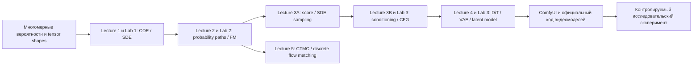

# От вероятностей к исследованию генеративных видео- и аудиомоделей

<!-- study-navigation:start -->
**Основа:** [MIT 6.S184 / 2026](https://diffusion.csail.mit.edu/2026/index.html) · [Основной конспект](https://diffusion.csail.mit.edu/2026/docs/lecture_notes.pdf) · [Учебная карта](README.md).
<!-- study-navigation:end -->

Этот маршрут связывает пять предоставленных лекций MIT 6.S184, три исходные лабораторные, курс Kandinsky и практику ComfyUI/PyTorch. Главный результат каждого этапа: **формула → предсказание → работающий код → измерение → объяснение**. Переход определяется проверяемым навыком, а не количеством просмотренных видео.

Материалы проверены 27 октября 2026. [Индекс источников и страниц](references/materials_manifest.json), [атрибуция](references/README.md), [важные уточнения](SOURCE_NOTES.md). Номера страниц ниже — физические страницы PDF, начиная с 1; индексы ячеек — с 0.

## Начать здесь

1. Откройте [мост по многомерным вероятностям и соглашениям](notebooks/00_probability_and_model_contracts.ipynb). Он работает на CPU, не скачивает данные/веса и подготавливает обозначения для всех labs.
2. Пройдите Lecture 1 и Lab 1, затем чередуйте лекционные и практические блоки по таблице ниже.
3. После каждого блока оформляйте небольшой [отчёт](EXPERIMENT_TEMPLATE.md). Если объяснение не сходится с экспериментом, сначала разберите причину.
4. После Lecture 4 воспроизведите один и тот же компонент в Python и ComfyUI, затем найдите его в закреплённом промышленном коде.
5. Пройдите отдельную [CTMC-лабораторную Lecture 5](../lecture_05/05_ctmc_and_discrete_flow.ipynb). Это расширение курса, а не недостающая часть исходного Lab 3.

Запуск из корня репозитория:

```bash
uv run --locked jupyter lab curriculum/notebooks/00_probability_and_model_contracts.ipynb
```

Здесь используется корневая `.venv`. У `kandinsky-5/` своё окружение; у ComfyUI Desktop своё. Не устанавливайте исследовательские пакеты в `.venv` Desktop. MLX пока необязателен.

## Карта зависимостей



## Порядок работы и критерии перехода

Пять лекций и три labs **не образуют пять пар**. Lab 2 использует Lecture 2–3, Lab 3 — Lecture 3–4. Не нужно сначала прочитать все пять лекций, а потом открывать notebooks.

| Этап | Читать / смотреть | Выполнить в Python/PyTorch | Проверка перед переходом | ComfyUI / индустриальный смысл |
|---|---|---|---|---|
| P0 | Конспект, Appendix A, PDF pp.70–71 | [Вводный notebook](notebooks/00_probability_and_model_contracts.ipynb), §1 | Различать одну точку, batch, плотность, covariance; проверить off-diagonal covariance и Gaussian score | Вектор latent — совместное распределение, не набор независимых пикселей |
| P1 | [Lecture 1](../lecture_01/README.md), slides pp.7–25; notes §2.1, pp.7–9 | Lab 1 Parts 0–1 | Euler на `dx/dt=-x`: сходимость при уменьшении шага при том же T | Отделить neural predictor от sampler; [C1–C2](COMFYUI_LABS.md) |
| P2 | Lecture 1 slides pp.27–34; notes §2.2, pp.10–13 | Lab 1 Part 2, затем Part 3 | Brownian variance ∝ T; OU transient и stationary moments; score Gaussian | Seed, дополнительный sampling noise и cache — разные вещи |
| P3 | [Lecture 2](../lecture_02/README.md), pp.5–20,25–34; notes §3, pp.14–24 | Lab 2 Parts 1–2.3 → 3.1 → 4.1–4.3 | Вывести velocity target, различить conditional path и marginal field; проверить held-out loss и конечные samples | Noise schedule не заменяет обучение; steps/NFE/time [C2](COMFYUI_LABS.md) |
| P4 | [Lecture 3A](../lecture_03/README.md), pp.6–23; notes §4, pp.25–33 | Вернуться к Lab 2 Q2.4, Q3.2–3.3 | Проверить score и conversion только внутри допустимого диапазона t; сравнить ODE/SDE marginals | Одинаковая предельная плотность не означает одинаковые траектории |
| P5 | Lecture 3B pp.24–37; notes §5, pp.34–40 | Lab 3 Parts 1–2, Q2.2–2.4 | Label dropout; CFG при w=0/1; branch accounting; MLP conditional generation | [C3](COMFYUI_LABS.md): guidance только на поддерживающей CFG модели |
| P6 | [Lecture 4](../lecture_04/README.md), pp.20–28; notes §6.1, pp.41–46 | Lab 3 Part 3, Q3.1–3.5 | Patchify/unpatchify, attention, modulation, time/class embeddings, output shape и training | DiT из toy images → video latent tokens; [C5](COMFYUI_LABS.md) |
| P7 | Lecture 4 pp.3–19; notes §6.2, pp.46–52 и Appendix D, pp.77–82 | Lab 3 Part 4 → Part 5 | KL/reconstruction units, posterior sampling; заморозить VAE при latent training | [C4](COMFYUI_LABS.md): VAE reconstruction без Qwen/DiT; затем полный latent pipeline |
| P8 | [Lecture 5](../lecture_05/README.md), pp.5–28,37–40; notes §7, pp.54–66 | [Дополнительная CTMC lab](../lecture_05/05_ctmc_and_discrete_flow.ipynb) | Rate matrix, positivity, probability conservation, exact vs simulated distribution, masked-token loss | Отличать дискретные token IDs conditioning от CTMC-генерации текста |
| R | [Карта архитектур](INDUSTRY_BRIDGE.md) и [протокол](RESEARCH_PROTOCOL.md) | Один воспроизводимый component/adapter experiment | Baseline, один фактор, held-out data, несколько seed, ограничения вывода | Один кейс: Hunyuan/Wan/Kandinsky/LTX/Mochi/Open-Sora |

Промышленный continuous-video маршрут можно начинать после P7; P8 — отдельная ветвь про discrete state spaces, а не обязательная предпосылка Hunyuan/Wan/Kandinsky.

P4 можно изучать после P3, а линейный path Lab 2 Part 4 — до score matching. Q2.4 намеренно откладывается до определения score. В Lecture 4 слайды сначала вводят VAE, а исходный Lab 3 сначала DiT: прочитайте обзор VAE, затем выполните **Part 3 → Part 4 → Part 5**, чтобы не сломать зависимости кода. Темы переиспользуются, а не проходят один раз навсегда.

## Как провести одно занятие

- Сначала сформулируйте вопрос и нарисуйте входы/выходы, включая shapes и единицы.
- Выведите формулу на маленьком случае: 1D, одна Gaussian, два tokens, один patch.
- До запуска запишите ожидаемую кривую или знак изменения. Изменяйте один параметр.
- Реализуйте минимальный пример и проверьте аналитический ответ или invariant.
- Выполните опыт на отложенных данных/seed. Сохраните config, числа и рисунок.
- Письменно объясните отличие теории от конечного шага, конечного batch и приближённой сети.

Обычно это 1–3 занятия на один этап; это ориентир планирования, не обещание срока обучения. Если не закрыт критерий перехода, уменьшите пример, а не увеличивайте модель.

## Общие обозначения: три разных смысла conditioning

| Объект | Смысл | Типичная форма |
|---|---|---|
| `x_t` | Текущее зашумлённое состояние | `[B,d]` или `[B,C,T,H,W]` |
| `z` в MIT probability path | Фиксированный чистый endpoint из датасета | Та же размерность, что у `x_t` |
| `y` | Класс, текст или иное внешнее условие | `[B]`, token IDs или embeddings |
| `p_t(x ∣ z)` | Удобный для обучения conditional path | Endpoint известен при training |
| `p_t(x)` | Marginal path после усреднения по endpoint | Именно его должен воспроизвести unconditional sampler |
| `p_t(x ∣ y)` | Распределение под внешним условием | Guided generation |
| `z` в VAE-коде | Latent representation изображения/аудио | Другое использование буквы z; переименуйте в `latent` |

CFM даёт доступные targets с известным endpoint, а sampler не получает будущую чистую картинку. Его поле — условное ожидание endpoint-specific velocity при известном текущем состоянии. Не усредняйте conditional fields с постоянными весами, если нужны posterior weights.

## Соглашение о времени записываем в каждом эксперименте

**MIT: от шума к данным.** Начальное состояние — Gaussian noise, конечное — чистый объект. Обозначим чистый endpoint через `x_data`, а шум через epsilon:

$$
x_s = (1-s)\epsilon + s x_{\mathrm{data}}, \qquad s \in [0,1].
$$

Sampling идёт от `s = 0` к `s = 1`. Target для линейного path:

$$
u_s^{\star} = x_{\mathrm{data}} - \epsilon.
$$

**Сравниваемое соглашение Kandinsky: от данных к шуму.** Здесь то же состояние записывается иначе:

$$
x_t = (1-t)x_{\mathrm{data}} + t\epsilon, \qquad t \in [0,1].
$$

Генерация идёт в обратную сторону: от `t = 1` к `t = 0`. Target относительно координаты `t`:

$$
v_t^{\star} = \epsilon - x_{\mathrm{data}}.
$$

Связь соглашений:

$$
s = 1-t, \qquad u_s^{\star} = -v_t^{\star}.
$$

Состояния совпадают при замене времени; знак скорости меняется. Обозначения `u` и `v` здесь относятся к производным линейного path, а не к любому параметру с именем `v` в diffusion-библиотеке.

В конкретном pipeline дополнительно проверьте time scaling, shift и prediction type: epsilon/velocity/policy нельзя подменять по названию файла.

Probability path задаёт распределения в каждый момент; он сам по себе не задаёт единственную траекторию частицы. Аналогично, одинаковые marginals ODE и SDE не требуют одинаковых sample paths.

## Дополнительные чтения по месту в курсе

[Rectified Flow, обзоры Lilian Weng и контрольные опыты](SUPPLEMENTARY_READING.md) привязаны к Lecture 2–4. Сначала основная MIT lab, затем дополнение. Они не являются новой обязательной ветвью.

## Что открывать после основного курса

- [Kandinsky 5: 14 лабораторных](../kandinsky-5/README.md): VAE → text embeddings → attention/DiT → Flow Matching → sampling → локальный/CUDA pipeline. Это увеличенный масштаб тех же понятий.
- [Kandinsky 6: ручной notebook](../kandinsky-6/notebooks/00_manual_experiment_comfy_mlx_film.ipynb): совместные audio/video latents, Distill/PiFlow, frozen/trainable map и будущий FiLM experiment.
- [ComfyUI experiments](COMFYUI_LABS.md): визуальная проверка и измерения; наблюдения не заменяют формальный вывод.
- [Архитектурные точки входа](INDUSTRY_BRIDGE.md): читать код выбранной revision, а не смешивать API разных моделей.

Полное клонирование голоса — завершающий исследовательский проект после этих навыков. Сейчас он остаётся гипотезой: нельзя считать обучение маленького FiLM на случайных признаках результатом для pretrained CrossDiT.

## Apple M3 Max: рабочие режимы

40 GPU cores — это ядра одного Apple GPU, не 40 отдельных видеокарт. 48 GB — общий пул CPU/GPU. Ёмкость SSD 1 TB не равна свободному месту. По текущему решению пользователя полная генерация и загрузка больших моделей отложены до **50 GB+ свободного места**.

1. **Сейчас:** CPU PyTorch, аналитические проверки, небольшие networks, просмотр кода, подготовка workflow, synthetic experiments без downloads.
2. **После проверки ресурсов:** MPS на уменьшенном варианте, затем один pretrained component и ComfyUI baseline. Сохраняем фактические ограничения operators/dtype.
3. **MLX:** переносить уже проверенный маленький блок; передавать одни и те же weights и inputs, проверять forward/gradient parity и только затем latency. Одинаковый seed в двух frameworks не даёт одинаковые random tensors. Используйте явный `mx.eval`; в PyTorch MPS — synchronize при измерении.
4. **Облако:** только если зафиксирован bottleneck и нужен тот же эксперимент на CUDA. Ни скорость H100, ни размер adapter не предсказывают peak memory полного backward на Mac.

## Проверенные материалы

[Отчёт с результатами и графиками](reports/VALIDATION.md): две новые лабораторные, 30 cells / 14 code cells, выполнены на CPU. Исходные Lab 1–3 сохранены без изменений и остаются самостоятельными заданиями. Новые ComfyUI graphs прошли статическую проверку; runtime, MLX и pretrained generation пока не выполнялись.

## Поддержка навигации

После повторной генерации авторских notebooks выполните `python curriculum/scripts/sync_study_navigation.py --write`, затем `--check`. Утилита меняет только навигационный Markdown; код ячеек, канонические originals и пользовательские notebooks Lecture 1 не изменяются.
