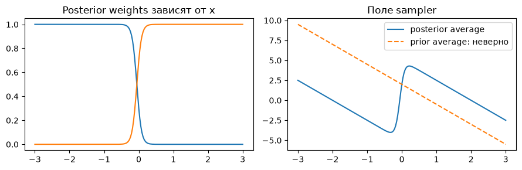
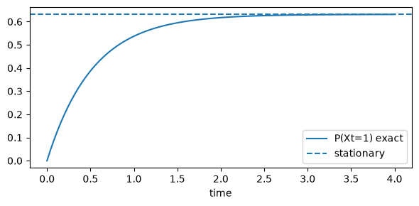
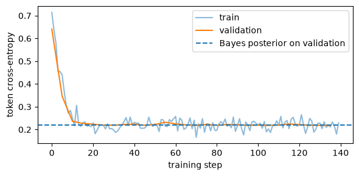

# Проверка учебного маршрута, 27 октября 2026

Фактическое окружение исполнения: Python 3.12.14, Torch 2.8.0, NumPy 2.5.3. Проверка использовала существующее исследовательское окружение; новый `uv sync` и установка зависимостей в ComfyUI не выполнялись.

## Что выполнено

Два новых notebooks выполнены в свежих Python 3.12 / PyTorch CPU kernels: **30 ячеек, 14 code cells**. Pretrained weights и данные из сети не загружались, ComfyUI jobs не отправлялись, MLX не запускался. Выполненные копии остаются в ignored `reports/executed/`; исходные учебные notebooks публикуются без outputs.

| Проверка | Результат |
|---|---|
| Gaussian score vs analytic | max abs 4.44e-16 |
| Time reversal states | max abs 1.11e-16 |
| Marginal velocity/score conversion | max abs 2.66e-15 |
| CFG w=0/1, separate/batched branches | PASS, случайная MLP, без генерации изображений |
| Patchify roundtrip | Точное восстановление pixels |
| Frozen codec gradients | Отсутствуют; gradients predictor конечны |
| CTMC: exact P(XT=1) | 0.617450039 |
| Gillespie, N=12000 | 0.616916667; binomial SE 0.004437 |
| Euler CTMC probability error | 0.014125 при 4 шагах → 0.000397 при 256; слишком большой шаг нарушает positivity |
| Toy categorical denoiser | 732 parameters, 140 steps; validation CE 0.718119 → 0.222189 |
| Bayes posterior validation CE | 0.218639; ambiguity полностью masked input не исчезает |
| Toy posterior max error | 0.072777 |
| Original Lab 1/2/3 hashes | Совпали с вложениями; оригиналы не выполнялись |
| Пользовательские ответы Lecture 1 | Контрольные суммы не изменились |
| Новые ComfyUI graphs | Links/types проверены; runtime не запускался |
| Карта официального кода | 5 repositories, revisions и SHA-256 выбранных файлов |
| Локальные ссылки руководств | PASS |

[Машиночитаемый отчёт](validation.json).

## Что показывают графики



На заданной аналитической смеси prior averaging не заменяет posterior marginalization. Это exact toy calculation, не результат обучения видеомодели.



Непрерывно меняется law процесса; отдельный state меняется скачками.



Снижение cross-entropy относится к synthetic two-token distribution. Это не обучение language model и не полный learned CTMC sampler.

## Повторная проверка

Из корня репозитория:

```bash
uv run --locked python curriculum/scripts/validate_curriculum.py --execute
```

Без `--execute` выполняются проверки схемы/ссылок, но отчёт execution будет `not_run`. Новые bridge/CTMC notebook checks не означают, что решены исходные Lab 2/3, проверен полный MNIST training или пройден MLX/pretrained inference.

Полная генерация и загрузка больших моделей остаются отложены до освобождения 50 GB+ на SSD; это пользовательское решение не отменялось.
