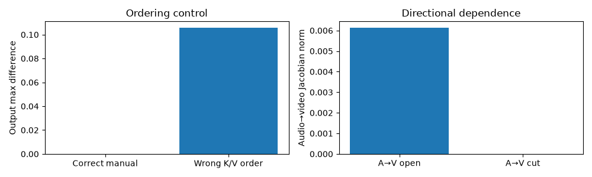
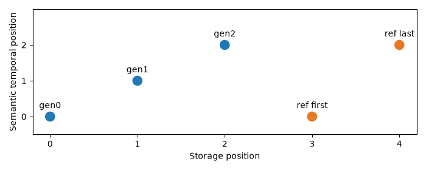
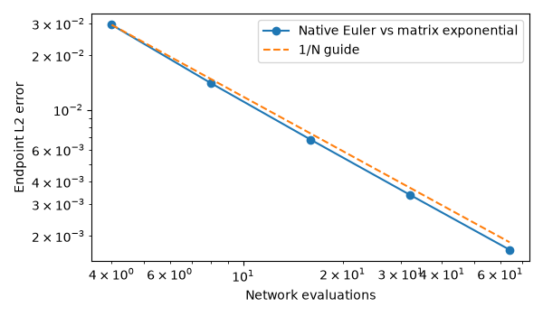
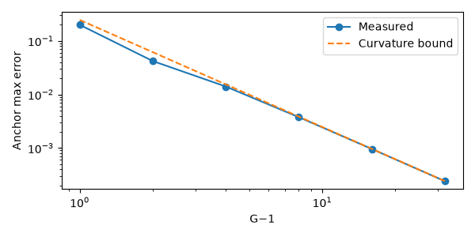
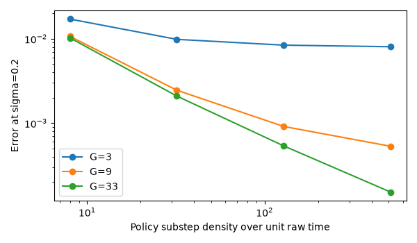
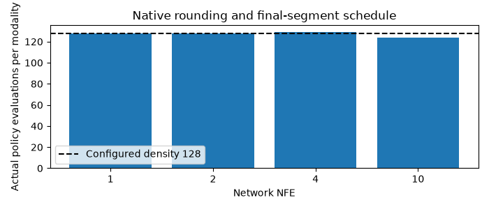
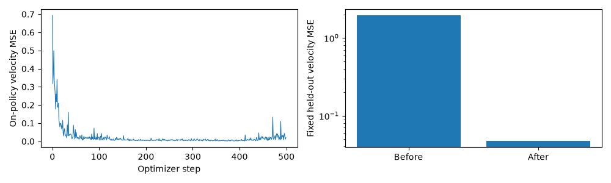

# DiT / CrossDiT / π-Flow: измеренные CPU результаты

[Маршрут](../README.md) · [MIT questions](../MIT_BRIDGE.md) · [Границы source/adapter](../SOURCE_MAP.md) · [Полный execution JSON](execution.json) · [Формулы](math-rendering.json).

**11/11 notebooks, 66 code cells, 168 cells всего исполнены в fresh CPU kernels.** Дата UTC: 2026-10-27T17:23:10.618032+00:00. Python 3.12.14. Проверено 18 selected source/config files и 3 canonical MIT originals. Hash каждого notebook и adapter/helper сохранён. Все **47 display formulas** прошли strict KaTeX parse/render; это не GitHub/Colab renderer parity.

Материалы проверяют analytic fields, random reduced K5/K6 blocks и explicit dependency doubles. Pretrained weights, CUDA/MPS execution, production latency/VRAM, ComfyUI runtime и MLX parity **не выполнялись**.

## Гипотезы и controls

1. **Matched dense block:** K5 visual+text block и K6 single-stream counterpart при одинаковых весах/FP32 adapter дают одинаковую функцию. Проверяется narrow block, не whole-model parity.
2. **Fusion order/dependence:** original K6 block равен stepwise manual assembly; неправильный pre/post-text K/V порядок меняет output. Отдельный directional cut устраняет только выбранную зависимость в одном блоке.
3. **Solver:** native Euler сходится к exact matrix-exponential solution известного linear field; CFG меняет branch count, а не число интегрируемых trajectories.
4. **Policy:** grid approximation и ODE integration errors различаются; substep density не равна NFE×density.
5. **Imitation:** detached student rollout / frozen teacher сохраняют gradient routing; обучаемый MLP уменьшает fixed held-out velocity error на 2D field. Это single-seed toy experiment, а не статистический benchmark K6.

## Формулы и native блоки

| Проверка | Измерение | Область вывода |
|---|---|---|
| Affine velocity finite difference | max error 4.65e-12 | Time convention/derivative |
| Correlated Gaussian velocity→score | max error 1.78e-15 | Conditional expectation / covariance algebra |
| Manual attention vs native | max error 5.96e-08 | Dense tiny FP32 attention |
| adaLN-Zero inner gradient | 0 | Closed residual branch, first backward |
| adaLN modulation gradient | 0.031850 | Zero init не запрещает обучение gates |
| K5↔K6 matched block | max error 0 | Explicit FFN key/precision/backend mapping |
| Fused manual assembly | max error 0 | Both streams, all four flags checked |
| Wrong K/V ordering | max difference 0.105754 | State ordering действительно меняет функцию |
| Audio→video Jacobian | norm 0.006133 | Local dependence присутствует |
| Audio→video cut Jacobian | norm 0 | Chosen edge removed, one block |
| Two asymmetric cross-attentions | 13152 parameters | Совпало с аналитическим count, excludes outside gates/norm |
| Masked text perturbation | max error 0 | Boolean keep-mask contract |
| RoPE precomputed/rebuilt | max error 0 | Same coordinates, random native tiny |



Conditioning helpers исполнялись на codec doubles; input validation, RGB normalization, scale, layout и no_grad проверены, semantic encoder/codec quality не измерялась. Visual reference tests покрывают batched/packed B=2,R=2, role masks, in-place restoration, projector idempotence и semantic t0/tlast RoPE.



## Euler convergence и CFG accounting

[CSV](euler-convergence.csv). Exact reference: exp(−A)x₁ для A=[[0.7,0.2],[0.3,0.4]]. Source denoise loop использует negative shifted time increments и network time 1000σ.

| Steps / NFE | Endpoint L2 error |
|---|---|
| 4 | 0.02953677 |
| 8 | 0.01400864 |
| 16 | 0.00683171 |
| 32 | 0.00337466 |
| 64 | 0.00167718 |



Для 8 steps CFG=1 дал 8 network calls; CFG=0/3 дали 16. Constant-bias field endpoints совпали с algebra (float32 tolerance). При frozen audio tensor не изменился и audio conditioning time был 0. Полный fused DiT при этом всё ещё может вычислять оба streams.

## π-Flow grid, время и реальная стоимость substeps

[Grid/solver error CSV](policy-rollout-error.csv), [budget CSV](policy-budget.csv). Warp inverse/Jacobian и interpolation curvature bound проверены. Polynomial branch протестирована как coefficient basis, не как grid samples. copy/detach не объявляются deep clone; MultimodalDXPolicy покрыта отдельно.





При fixed grid рост density уменьшает discretization error до representation floor на аналитическом curved-anchor примере. Near-endpoint velocity error усиливается как 1/max(σ,eps). Это не универсальная гарантия quality при росте substeps у trained модели.

| Network NFE | Grid G (example) | Configured density | Actual policy evaluations per modality |
|---|---|---|---|
| 1 | 10 | 128 | 128 |
| 2 | 10 | 128 | 128 |
| 4 | 10 | 128 | 129 |
| 10 | 10 | 128 | 124 |

Для S=10,r=.5,K=128 фактически 124 evaluations: 9×13+7. Native random grid-DiT при S=2 вызван ровно 2 раза при densities 8/32/128; outputs сохранили physical shapes и finite values. В batch с двумя durations source делает 12 vectorized policy calls, active updates на rows — 12 и 5; не 17 отдельных batch calls.



## Маленький π-ID эксперимент

Teacher — frozen 2D linear field, student — MLP с G=5 anchors, 500 Adam steps, seed23. Training: fresh sources, detached on-policy rollout, 500 teacher batch calls / 32000 queried training states. Fixed held-out probe содержит 512 sources и exact teacher states, построенные до training; target не используется optimizer.

| Метрика | До | После |
|---|---|---|
| Fixed held-out velocity MSE | 1.93776846 | 0.04728553 |
| Средний train loss, первые/последние 50 | 0.12813438 | 0.02400570 |

Held-out loss уменьшился в 40.98 раза относительно этой инициализации. Teacher weights неизменны, teacher.grad отсутствует, rollout states не требуют gradient. Train и fixed probe distributions различаются, поэтому их loss не надо напрямую приравнивать.



[Held-out trajectory CSV](heldout-trajectory.csv):

| Fraction of segment | State MSE to exact teacher | Student source calls |
|---|---|---|
| 0.25 | 5.7053194e-06 | 1 |
| 0.5 | 1.1749632e-05 | 1 |
| 0.9 | 0.00010342366 | 1 |

Это поддерживает гипотезу о работоспособности данного toy imitation mechanism. Не подтверждает K6/AV perceptual quality, production distillation speed или Grönwall uniform assumptions по одному среднему loss. Реальная K6 distillation/Sim-LADD, teacher CFG и paired AV data не воспроизводились.

## Воспроизведение

```bash
uv run --locked --offline python dit/scripts/validate_labs.py --execute
uv run --locked --offline python dit/scripts/summarize_labs.py
```

Authored notebooks чистые; full executed copies и local HTML previews — ignored `artifacts/`. CSV, компактные JSON и 11 selected figures публикуются. [Lab10](../notebooks/10_comfyui_and_manual_research_protocol.ipynb) содержит ручной protocol после SSD gate; graph изучен статически, ни один ComfyUI job не отправлен.
