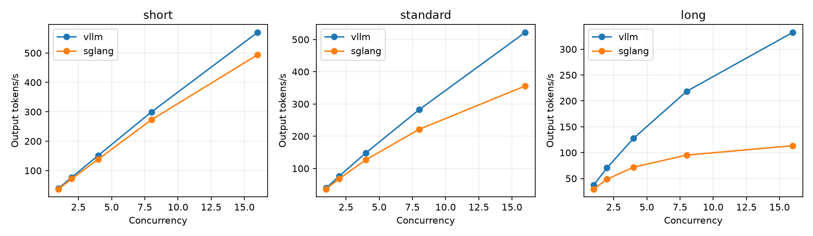
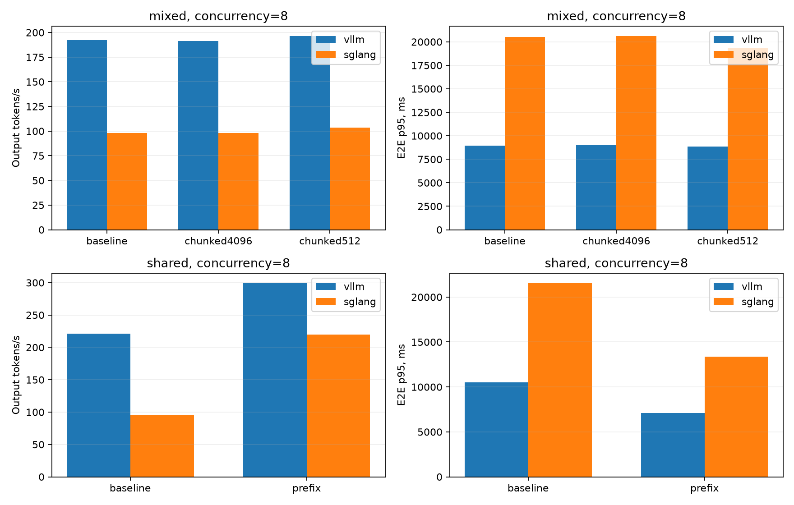
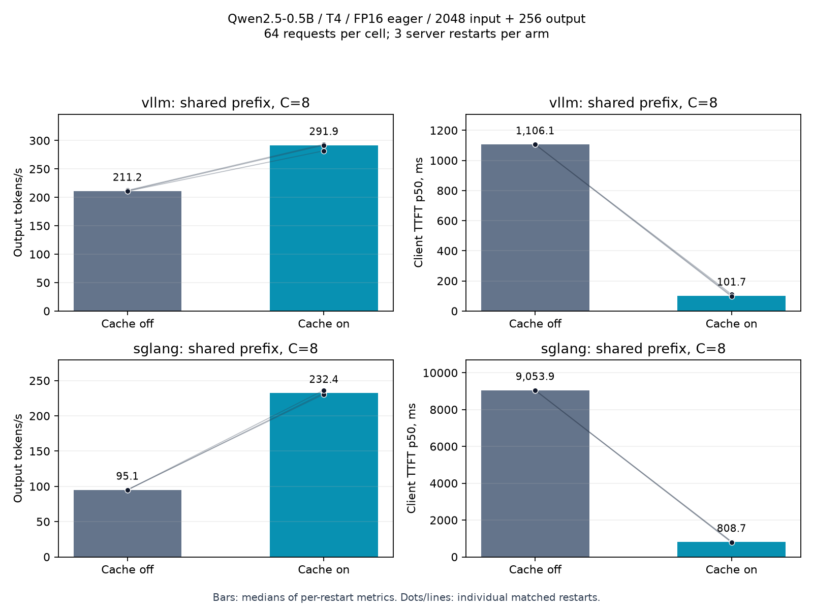

# LLM inference optimization — результаты T4

Измерения 30–31 октября 2026. Обе кампании завершены и проверены по raw данным:

- Пилот: **138 точек, 4416/4416 успешных timed requests, 712704 output tokens**.
- Дополнительная prefix-cache validation: **12 точек, 768/768 успешных timed requests, 196608 output tokens**; 64 запроса на точку, shape-matched warmup, оба движка на одной физической T4.

В [ответе рекрутеру](RECRUITER_ANSWER_RU.md) cache-цифры взяты из дополнительной проверки, описанной в разделе 11. Разделы 1–8 сохраняют отдельные результаты и ограничения пилота.

## 1. Hardware / software

В пилоте каждый движок использовал GPU 0: NVIDIA T4, SM75, 15360 MiB, driver 580.178.04, CUDA runtime 13.0. Доступны две T4 с PHB interconnect; TP=1, GPU 1 не участвовал в инференсе. В пилоте движки измерены в разных Kaggle allocations, поэтому прямое сравнение относится к полным software stacks на одном классе hardware. В дополнительной проверке оба работают последовательно на одной физической GPU 0; версии критичных packages совпадают с таблицей ниже.

| Stack | Engine | PyTorch | Transformers |
|---|---|---|---|
| vLLM | 0.31.0 | 2.13.0 | 5.17.0 |
| SGLang | 0.5.22 | 2.14.1 | 5.19.0 |

[vLLM environment](cuda-2026-10-30/vllm/environment.json) · [SGLang environment](cuda-2026-10-30/sglang/environment.json) · [Полные freezes и logs](cuda-2026-10-30/INFERENCE_OPTIMIZATION_REPORT.md).

## 2. Model / serving

`Qwen/Qwen2.5-0.5B-Instruct`, revision `7ae557604adf67be50417f59c2c2f167def9a775`, FP16, context 4096. Оба движка использовали одинаковые weights/tokenizer/chat template; проверены SHA-256 model files, workloads и benchmark harness. Это малая dense AR-модель для изучения serving, не video pipeline.

Серверы слушали loopback OpenAI-compatible API. На каждом старте проверялись health, model identity, streaming/non-streaming и простой semantic smoke. [Model manifest](cuda-2026-10-30/workloads/model.json) · [Merge validation](cuda-2026-10-30/merge-validation.json).

## 3. Методика

- Inputs 128/512/2048 tokens **с учётом chat template**, outputs 64/128/256. Отдельно mixed 50/50 short/long и shared prefix.
- Closed-loop concurrency 1/2/4/8/16, 32 запроса на точку, три server restarts на arm. Арм-порядок менялся по фиксированному seed.
- Temperature=0, seed=42, одинаковые generation parameters. Для нагрузки `ignore_eos=True`; token counts взяты из server usage и проверены против фактических заданных длин.
- Перед точкой четыре warmup-запроса 512→64, вне измерений. Это ограниченный прогрев; exhaustive shape/JIT warmup не подтверждён.
- Eager execution, CUDA graphs выключены. Baseline: prefix cache OFF, chunked prefill OFF; SGLang policy FCFS.
- Throughput = успешные фактические output tokens / полное wall time точки. TTFT — первый непустой text delta на клиенте. TPOT — client estimate; token ITL недоступна через text-only SSE. Inter-chunk timestamps сохранены отдельно.

С 32 запросами p95 остаётся описательной статистикой, p99 не используется для вывода. Нет production RPS/SLA утверждений. Фиксированные SLO для exploratory goodput указаны в [campaign.json](cuda-2026-10-30/campaign.json).

## 4. Baseline и shared-prefix результат

2048→256 tokens, concurrency=8. Таблица содержит медианы отдельных метрик по трём повторам.

| Engine / cache | Output tok/s | Client TTFT p50 | E2E p95 |
|---|---:|---:|---:|
| vLLM OFF | 220.95 | 1063.98 ms | 10.50 s |
| vLLM ON | 299.48 | 109.75 ms | 7.08 s |
| SGLang OFF | 95.20 | 9043.96 ms | 21.56 s |
| SGLang ON | 219.98 | 805.71 ms | 13.39 s |

Все homogeneous и mixed baseline точки находятся в [summary.csv](cuda-2026-10-30/summary.csv).

Дельты Prometheus counters подтверждают использование cache в shared замерах: около 96.1% queried prompt tokens у vLLM и 87.0–90.0% prompt tokens у SGLang. Это показатели разных engine-specific counters, а не эквивалентный microbenchmark реализаций. [Независимый аудит](cuda-2026-10-30/measurement-audit.json) также пересчитывает throughput и перцентили из raw данных, проверяет уникальность IDs, actual token counts и временные метки.

## 5. Парные ablations

Проценты считаются для каждого matched repeat отдельно, затем берётся медиана. Диапазон — наблюдаемый min/max трёх повторов, **не confidence interval**.

| Engine / intervention / C8 | Throughput change | Диапазон повторов | TTFT p50 change |
|---|---:|---:|---:|
| vLLM, chunked OFF→ON, budget 4096, mixed | −1.45% | −1.98…+0.75% | −1.79% |
| vLLM, budget 4096→512, mixed | +1.86% | +1.49…+4.65% | +11.42% |
| vLLM, prefix OFF→ON, shared | +35.41% | +33.54…+39.72% | −89.69% |
| SGLang, chunked OFF→ON, size 4096, mixed | −0.03% | −0.07…+1.34% | −11.07% |
| SGLang, chunk size 4096→512, mixed | +5.48% | −6.11…+6.74% | −49.43% |
| SGLang, prefix OFF→ON, shared | +133.61% | +120.18…+134.31% | −91.09% |

Размер chunk у SGLang и batch token budget у vLLM имеют разную внутреннюю семантику. Между движками эти значения не считаются эквивалентной реализацией одной scheduler policy. В mixed нагрузке отдельно проанализированы короткие запросы с теми же IDs: [scheduling report](cuda-2026-10-30/SCHEDULING_REPORT.md).

У SGLang в mixed C8 уменьшение chunk 4096→512 снизило **TTFT p50 короткой подгруппы** с медианы 1862.82 до 105.82 ms. Медиана парного изменения −94.47%, диапазон трёх повторов −95.87…−94.16%. Каждый повтор содержит только 16 коротких запросов 128→64, конкурирующих с 16 длинными 2048→256. Это exploratory subgroup result с ограниченным pilot warmup; более крупная cache validation его не перепроверяет. Aggregate throughput mixed C8 при этом изменился на +5.48% с диапазоном −6.11…+6.74%. Поэтому latency benefit этой подгруппы не выдаётся за устойчивое общее throughput ускорение или эффект смены scheduler policy.

## 6. Latency / throughput trade-offs

Prefix caching показал выраженный эффект на специально построенном общем длинном prefix. Это не прогноз ускорения произвольного чата. Для chunked prefill результаты небольшие или нестабильные, с различными изменениями latency; универсального выигрыша не установлено.

[Latency / concurrency](cuda-2026-10-30/plots/latency-concurrency.png) · [Latency / throughput](cuda-2026-10-30/plots/latency-throughput.png).

## 7. Memory и runtime integration

Сохранялись RAM RSS и nvidia-smi samples для каждой физической GPU. Resident VRAM включает резервированные engine pools; RSS sum может повторно считать shared pages. Sampling не доказывает точный instantaneous tensor peak. Memory/scheduler bottleneck отдельно не изолирован.

[Memory plot](cuda-2026-10-30/plots/memory-concurrency.png). Начальный SIGKILL SGLang оказался следствием ошибки JIT linker: FlashInfer RMSNorm не находил `-lcuda`. Scratch-ссылка на настоящий `libcuda.so.1` и `LIBRARY_PATH` восстановили startup. [Первичный log](diagnostics/sglang-linker-v1/sglang/r0-baseline/server.log). Kernels и system CUDA не патчились.

## 8. Correctness / quality boundaries

Functional smoke и проверки token counts пройдены. Нагрузка использует synthetic filler и принудительную длину выхода; это не QA accuracy benchmark. Decoded output не был строго воспроизводим: в baseline/cache-on shared парах exact text совпал у vLLM в 43/96 случаях, у SGLang — в 27/96. Расхождения наблюдались и между повторами одного режима. Причина не изолирована; **сохранение общего качества и lossless parity не установлены**. Измеренное число output tokens при этом совпало во всех парах.

[Output agreement](cuda-2026-10-30/output-agreement.json). Скорость здесь относится к фиксированному вычислительному workload, а не к стоимости правильного ответа.

## 9. Что не выполнялось

Speculative decoding, изменение scheduler policy, TP=2/PP/FSDP inference, BF16/FP8, SGLang Diffusion/vLLM-Omni video inference и deployment внешних workers. Эти пункты не включены в ответ как практический опыт.

Notebook 03 завершил 64-request cache validation с 16 warmup той же длины и последовательным запуском обоих engines на одном GPU. Его результаты находятся отдельно в разделе 11 и не подставлены в таблицы пилота.

## 10. Engineering conclusion / reproducibility

Подтверждены работающий общий CUDA serving benchmark и крупный prefix-cache эффект в заданном synthetic shared-prefix сценарии; дополнительная проверка с shape-matched warmup поддержала этот вывод. Chunked prefill не дал устойчивого общего throughput выигрыша в пилоте, при этом у короткой подгруппы SGLang наблюдался выраженный latency benefit. Для дальнейшей настройки нужны выбранный production-like workload, больше наблюдений и отдельная проверка качества.

[Полный измеренный dataset](cuda-2026-10-30/) содержит raw requests/resources, workloads, environments, launch commands, логи, исходники обеих кампаний, source анализа и CSV/JSON summaries. Начальные неуспешные попытки сохранены в provenance/diagnostics и не считаются timed request successes. [Краткий ответ рекрутеру](RECRUITER_ANSWER_RU.md).

## 11. Дополнительная prefix-cache validation — 31 октября

[Приватный Kaggle notebook, версия 1](https://www.kaggle.com/code/applehawk/llm-inference-prefix-cache-validation-t4), статус COMPLETE. Запуск начат 30 октября в 21:38:31 UTC, то есть 31 октября в 00:38:31 МСК. [Provenance](prefix-validation-2026-10-31/measurement-provenance.json).

Только shared-prefix 2048→256, C=8, 64 запроса на точку и три независимых server restarts на каждый вариант. Перед точкой 16 отдельных warmup-запросов 2048→256; их ранние IDs отличаются от измеряемых prompts, поэтому длинный target prefix начинает заполняться при измерении. Оба движка последовательно используют одну физическую T4 GPU 0. Prefix OFF/ON — единственное изменение launch arguments внутри каждой пары; chunked prefill выключен. FP16, eager, TP=1, модель и generation settings сохранены.

Проверены все 768 timed requests и 192 исключённых harness warmup requests: IDs, actual input/output tokens, timestamps, throughput и перцентили. Ошибок нет. Model files/chat-template hashes совпадают с пилотом, benchmark harness идентичен, критичные версии packages подтверждены по freeze. [Независимый аудит](prefix-validation-2026-10-31/measurement-audit.json).

| Engine / cache | Output tok/s | Client TTFT p50 | E2E p95 |
|---|---:|---:|---:|
| vLLM OFF | 211.24 | 1106.05 ms | 10.37 s |
| vLLM ON | 291.85 | 101.74 ms | 7.27 s |
| SGLang OFF | 95.06 | 9053.85 ms | 21.70 s |
| SGLang ON | 232.39 | 808.74 ms | 13.58 s |

| Engine | Paired output throughput change | Диапазон трёх повторов | TTFT p50 change | E2E p95 change |
|---|---:|---:|---:|---:|
| vLLM | +38.16% | +33.62…+38.18% | −90.81% | −29.16% |
| SGLang | +145.15% | +142.07…+148.75% | −91.07% | −37.64% |

Абсолютные значения — медианы отдельных per-repeat метрик; проценты — медианы парных изменений. Наблюдаемые диапазоны не являются confidence intervals, p95 остаётся описательной статистикой. [Comparisons JSON](prefix-validation-2026-10-31/comparisons.json) · [Summary CSV](prefix-validation-2026-10-31/summary.csv).

Дельты counters показывают cached fraction около 97.6% queried prompt tokens у vLLM и 93.1–94.6% prompt tokens у SGLang. Семантика counters у движков различается. Exact decoded text baseline/cache-on совпал в **85/192** парах у vLLM и **31/192** у SGLang. Причина расхождений не изолирована; общая answer quality и lossless parity не установлены. Это производительность synthetic fixed-length load.

Количество запросов, warmup и размещение движков изменены относительно пилота; это отдельная проверка, а не дополнительные наблюдения прежнего протокола. Данные не объединялись в одну оценку. Она подтверждает cache benefit в выбранном сценарии, но не перепроверяет chunking, scheduler-policy tuning, production RPS или video inference. Первичные sources и notebook-generated reports сохранены рядом с отдельным analysis-source.
