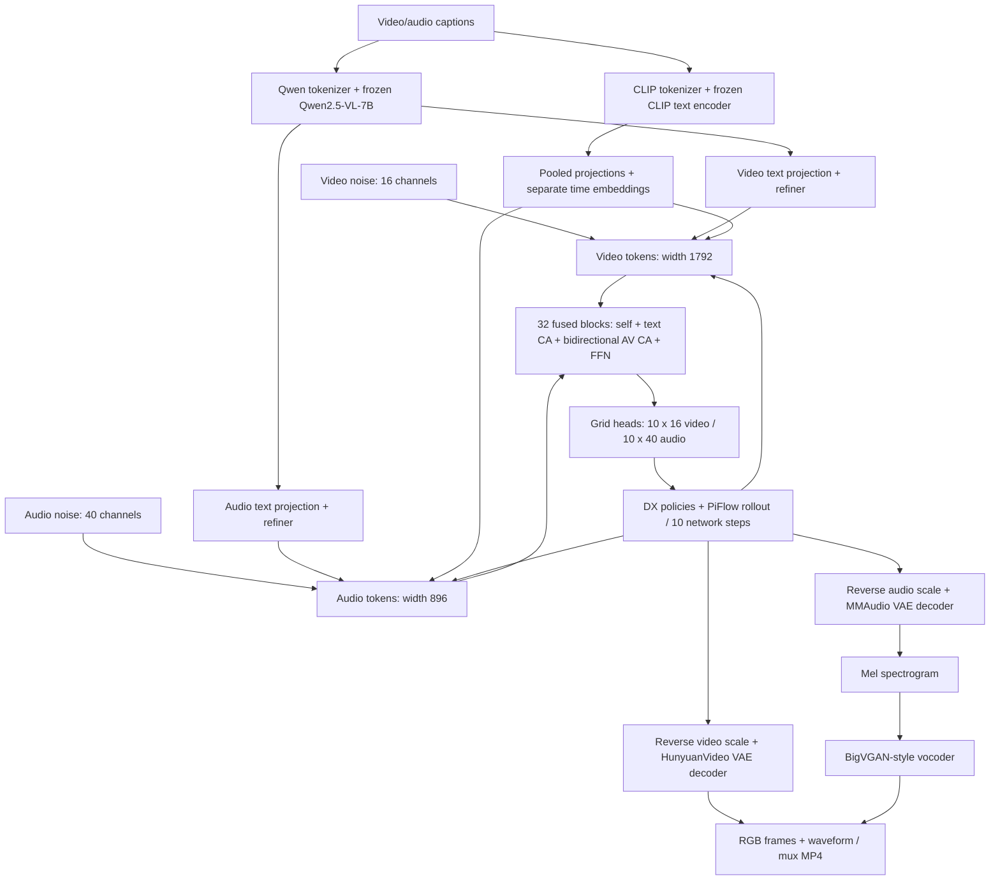

# Kandinsky 6 Lite — по-компонентный учебный курс

<!-- study-navigation:start -->
**Основа:** [MIT 6.S184 / 2026](https://diffusion.csail.mit.edu/2026/index.html) · [Основной конспект](https://diffusion.csail.mit.edu/2026/docs/lecture_notes.pdf) · [Учебная карта](../curriculum/README.md) · [Полное содержание](../curriculum/CONTENTS.md).
<!-- study-navigation:end -->

[Полное содержание всех материалов](../curriculum/CONTENTS.md) · [Общая учебная карта MIT → industry](../curriculum/README.md) · [Курс Kandinsky 5](../kandinsky-5/README.md).

Цель: понять **как устроен Kandinsky 6.0 Lite Distill 5s**, воспроизвести его операции на небольших тензорах и подготовиться к измеряемому запуску на M3 Max / 48 GB Unified Memory. Объяснения на русском, код Python/PyTorch. Архитектурная основа — [отчёт Kandinsky 6 на Hugging Face Papers](https://huggingface.co/papers/2610.05608) и [полный arXiv-текст](https://arxiv.org/html/2610.05608v1).

В курсе **14 самостоятельных лабораторных**: теория перед кодом, native tiny components, графики, численные контроли, упражнения и критерии понимания. В каждой есть ссылки на раздел отчёта, соответствующий K5 notebook и закреплённый официальный исходник. [Полная карта файлов/классов/методов](COMPONENT_GUIDE.md).

## С чего начать

Из корня репозитория, в основном Python 3.12 окружении:

```bash
uv sync --locked
uv run --locked jupyter lab kandinsky-6/notebooks/01_system_and_training_map.ipynb
```

Для этих CPU-лаб достаточно основного `uv.lock`; отдельная установка Diffusers/Transformers, окружения ComfyUI или MLX не требуется. Существующие оригинальные исходники читаются из `reference/`. Веса моделей не загружаются. На Mac используйте kernel корневой `.venv`; CPU выбран по умолчанию. [Проверенные результаты](reports/COMPONENT_VALIDATION.md).

В Colab выберите CPU runtime. Первая ячейка получает исходники курса из ветки `main`, если checkout отсутствует, и использует предустановленный PyTorch; pretrained-веса не скачиваются. Сравнение чисел Colab и Mac требует записи версии Torch, не bitwise равенства. В обычном локальном запуске сеть не требуется. Badges и checkout используют основную ветку main; файлы можно открывать и локально.

## Учебный маршрут

| № | Лабораторная | Конкретный результат | Colab |
|---|---|---|---|
| 01 | [K6 Lite: вся система и training map](notebooks/01_system_and_training_map.ipynb) | восстановить состав checkpoint и посчитать параметры каждого потока без выделения памяти под 3B весов | [](https://colab.research.google.com/github/vladislav-vasilenko/generative-ai-research/blob/main/kandinsky-6/notebooks/01_system_and_training_map.ipynb) |
| 02 | [Текст: tokenizer, Qwen, CLIP и два refiner](notebooks/02_text_conditioning.ipynb) | различать IDs, hidden states, pooled condition и padding mask; проверить crop и text-projection cache | [](https://colab.research.google.com/github/vladislav-vasilenko/generative-ai-research/blob/main/kandinsky-6/notebooks/02_text_conditioning.ipynb) |
| 03 | [Видео VAE: posterior, compression, causality и scaling](notebooks/03_video_vae.ipynb) | вывести VAE objective, обучить маленький codec и проверить causal Conv3d/latent normalization | [](https://colab.research.google.com/github/vladislav-vasilenko/generative-ai-research/blob/main/kandinsky-6/notebooks/03_video_vae.ipynb) |
| 04 | [Аудио: waveform → mel → VAE → vocoder](notebooks/04_audio_vae_and_vocoder.ipynb) | понять частотное представление, роль audio VAE и vocoder, проверить duration/scaling/clipping | [](https://colab.research.google.com/github/vladislav-vasilenko/generative-ai-research/blob/main/kandinsky-6/notebooks/04_audio_vae_and_vocoder.ipynb) |
| 05 | [Строительные блоки: patches, time, AdaLN и gates](notebooks/05_nn_patches_and_modulation.ipynb) | воспроизвести patch layout и проверить native modulation/residual на маленьких тензорах | [](https://colab.research.google.com/github/vladislav-vasilenko/generative-ai-research/blob/main/kandinsky-6/notebooks/05_nn_patches_and_modulation.ipynb) |
| 06 | [Attention и RoPE: текст, видео и аудио](notebooks/06_attention_and_rope.ipynb) | сравнить ручной attention с SDPA, измерить память и проверить геометрию вращений | [](https://colab.research.google.com/github/vladislav-vasilenko/generative-ai-research/blob/main/kandinsky-6/notebooks/06_attention_and_rope.ipynb) |
| 07 | [От DiT к CrossDiT: как denoiser устроен изнутри](notebooks/07_dit_and_text_crossdit.ipynb) | проследить путь latent→patches→blocks→velocity, отделить time/pooled modulation от token-level text cross-attention и отличить velocity head от π-Flow grid head | [](https://colab.research.google.com/github/vladislav-vasilenko/generative-ai-research/blob/main/kandinsky-6/notebooks/07_dit_and_text_crossdit.ipynb) |
| 08 | [Dual-stream CrossDiT K6: два потока Audio + Video](notebooks/08_dual_stream_audio_video_crossdit.ipynb) | по исходному коду восстановить порядок FusedTransformerDecoderBlock, источники Q и K/V обоих межмодальных attention и роль флагов, затем проверить wiring причинными опытами | [](https://colab.research.google.com/github/vladislav-vasilenko/generative-ai-research/blob/main/kandinsky-6/notebooks/08_dual_stream_audio_video_crossdit.ipynb) |
| 09 | [Joint Flow Matching: path, velocity и учебное обучение](notebooks/09_flow_matching_training.ipynb) | вывести target в noise→data sampling convention и обучить настоящий tiny joint CrossDiT | [](https://colab.research.google.com/github/vladislav-vasilenko/generative-ai-research/blob/main/kandinsky-6/notebooks/09_flow_matching_training.ipynb) |
| 10 | [Lite Distill: grid-head, DX policy и π-Flow](notebooks/10_piflow_distillation.ipynb) | разобрать 160/400 outputs, выполнить native grid forward и отдельно network-free policy rollout | [](https://colab.research.google.com/github/vladislav-vasilenko/generative-ai-research/blob/main/kandinsky-6/notebooks/10_piflow_distillation.ipynb) |
| 11 | [Sampling: Euler, CFG, schedules и NFE](notebooks/11_sampling_cfg_and_nfe.ipynb) | измерить ошибки solver и фактическое число calls в настоящем native denoise_loop | [](https://colab.research.google.com/github/vladislav-vasilenko/generative-ai-research/blob/main/kandinsky-6/notebooks/11_sampling_cfg_and_nfe.ipynb) |
| 12 | [Latents, I2AV references, decode и output contracts](notebooks/12_latents_conditioning_and_output.ipynb) | проверить shapes/offsets, воспроизвести visual reference channels и разобрать encode/decode API | [](https://colab.research.google.com/github/vladislav-vasilenko/generative-ai-research/blob/main/kandinsky-6/notebooks/12_latents_conditioning_and_output.ipynb) |
| 13 | [Runtime: память, offload, cache и путь к Apple MLX](notebooks/13_runtime_memory_and_mlx.ipynb) | составить ресурсный бюджет и план переноса с измеримыми parity gates | [](https://colab.research.google.com/github/vladislav-vasilenko/generative-ai-research/blob/main/kandinsky-6/notebooks/13_runtime_memory_and_mlx.ipynb) |
| 14 | [ComfyUI: от визуального baseline к отдельному исследованию](notebooks/14_comfyui_component_experiments.ipynb) | связать UI nodes с кодовыми компонентами и подготовить измеряемые однородные A/B опыты | [](https://colab.research.google.com/github/vladislav-vasilenko/generative-ai-research/blob/main/kandinsky-6/notebooks/14_comfyui_component_experiments.ipynb) |

Основная последовательность: **01 → 02 → 03 → 04 → 05 → 06 → 07 → 08 → 09 → 10 → 11 → 12 → 13 → 14**. Если основы K5 уже пройдены, прочитайте контракты 01–06, затем выполните 07–12. Для исследования голоса после этого переходите к [ручному журналу эксперимента](notebooks/00_manual_experiment_comfy_mlx_film.ipynb).

**Особый фокус:** [07 DiT / text CrossDiT](notebooks/07_dit_and_text_crossdit.ipynb) и [08 Dual-stream Audio+Video CrossDiT](notebooks/08_dual_stream_audio_video_crossdit.ipynb) — разные лабораторные. Вторая показывает оба направления Q/K/V, точный порядок residual updates, separate time conditioning, RoPE, cross-gates, perturbation cuts и gradient flow. Dual-stream здесь означает две модальности, а не стереоканалы.

## Архитектура минимального Lite Distill



Это карта основного генератора. SR — отдельный pipeline с другим KVAE latent contract. Beautifier — опциональная подготовка prompt. В минимальном Smoke их нет. Native и Diffusers реализации могут отличаться упаковкой tensors/API; изучаем pinned native код и явно сверяем HF configs, не смешиваем их конструкторы.

## Training map: какие веса и когда обучаются

| Компонент | Происхождение / роль | В полном FM учебном контракте | В нашем frozen-FiLM исследовании |
|---|---|---|---|
| Qwen2.5-VL-7B + processor/tokenizer | Внешний Qwen: 3584-wide token context, до 1024 tokens после crop | Encoder frozen; tokenizer фиксирован | Frozen |
| CLIP ViT-L/14 text tower + tokenizer | Внешний CLIP: pooled 768, до 77 tokens | Encoder frozen; tokenizer фиксирован | Frozen |
| HunyuanVideo VAE | Внешний codec: 16 channels, temporal ×4, spatial ×8 | Frozen при обучении DiT | Frozen |
| MMAudio VAE | Внешний mel/latent codec: 40 channels, 44100 Hz | Frozen при обучении DiT | Frozen |
| BigVGAN-style vocoder | Внешние waveform synthesis weights; отдельны от VAE | Frozen | Frozen |
| Video stream: patches, text-refiner, time, blocks, out | Kandinsky, video initialization от K5 | Trainable | Frozen |
| Audio stream: embeddings, refiner, time, blocks, out | Kandinsky, собственное аудиообучение | Trainable | Frozen |
| AV fusion Q/K/V, norms/modulation/gates | Kandinsky, межмодальный обмен | Trainable | Frozen |
| Token Role Embeddings | Kandinsky, noisy/reference frame roles | Trainable | Frozen |
| RoPE / sinusoid / masks / shift / solver | Формулы и buffers, не отдельная pretrained сеть | Нет optimizer weights | Нет optimizer weights |
| PiFlow expanded output heads | Часть distilled DiT checkpoint | Не используем в обычном velocity-training опыте 09; исследуем в 10 | Frozen |
| Speaker-FiLM | Наш предлагаемый адаптер | Не часть stock K6 | Только этот добавленный слой trainable; пока гипотеза |
| SR-DiT + latent upscaler + KVAE | Отдельная SR ветвь | Не входит в основной Lite опыт | Не нужен для первого voice опыта |

Эта таблица задаёт **наши контракты опытов**, не универсальный optimizer всей истории Kandinsky. Статья §4 описывает разные стадии: separate/joint pretraining, SFT, RL и distillation. В SFT stage 1 обучается video branch при frozen audio/fusion; stage 2 размораживает DiT-модули. В inference optimizer отсутствует; `eval()` и `requires_grad_(False)` — разные операции. Полный industrial trainer в этом inference snapshot не воспроизводится.

## Ключевые shapes и checkpoint-specific детали

| Величина | Lite / Lite Distill |
|---|---|
| Video/audio widths | 1792 / 896 |
| Video/audio FF widths | 7168 / 3584 |
| Video/audio heads | 28 / 14 при head_dim=64 |
| Fused blocks / text blocks per branch | 32 / 2 |
| Video patch | 1×2×2; 33 input channels → Linear 132→1792 |
| Physical latent channels | Video 16; audio 40 |
| Обычный FM output | Video 16; audio 40 |
| Distill output | Video 160; audio 400 = 10 grid points × channels |
| 121 frames, 480×864 | Video latent 31×60×108×16; 50220 video tokens; 218 audio latent steps |
| Video scale | 0.476986 |
| Audio scale | **0.417 для Lite Distill**, 0.5302 для plain Lite native config |
| Time | normalized state path 0=data / 1=noise; DiT input 1000×time |
| Default distill sampler | 10 network steps, CFG=1, shift=5, grid=10, policy substeps=128 |

Метаданные: [HF transformer config](reference/hf/Kandinsky-6.0-Lite-distill-5s-Diffusers/transformer/config.json), [codec/scheduler configs](reference/hf/Kandinsky-6.0-Lite-distill-5s-Diffusers), [native checkpoint config](reference/kandinsky-6/kandinsky/configs/checkpoints/lite-distill.yaml).

В 01 native constructor на `meta` насчитал **3 177 988 112 параметров** для выбранного expanded config без чтения весов: video 2 008 739 200, audio 574 096 016, fusion 595 152 896. Наша группировка относит cross-modal modulation к fusion; округлённая архитектурная разбивка статьи и такое именование state_dict не тождественны. BF16 storage только DiT составляет около 5.919 GiB; это не peak RAM всего pipeline.

## ComfyUI и отдельное исследование

| Workflow | Размеры | Назначение |
|---|---|---|
| [Lite Smoke](workflows/k6_lite_distill_smoke.json) | 432×256, 33 frames | Проверить установку и ресурсы |
| [Lite Baseline](workflows/k6_lite_distill_baseline.json) | 864×480, 121 frames | Воспроизводимые 5s замеры |

Оба: seed=42 fixed, 10 steps, CFG=1, audio scale=.417, 12 nodes / 14 links, без Pro/SR/beautifier/MagCache. [Общий ComfyUI маршрут C0–C6](../curriculum/COMFYUI_LABS.md) → [K6 component UI lab 14](notebooks/14_comfyui_component_experiments.ipynb) → [ручной K6 журнал](notebooks/00_manual_experiment_comfy_mlx_film.ipynb) → [подробный протокол](COMFYUI_AND_EXPERIMENT_RU.md).

После разрешения пользователя 30 октября необходимые Lite веса установлены в Desktop. Untiled video decode baseline упал на MPS с буфером 75.16 GiB; графы переведены на **VAEDecodeTiled: 256 / 64 / 16 / 4**. [Проверка на MPS](reports/comfy-tiled-vae-validation.json): baseline 864×480 / 121 кадр успешно декодирован и сохранён со звуком. Продолжение заняло 563.51 s (~9 min 24 s), Sampler и audio decode взяты из cache; это время постобработки, не полной генерации. Ветка SR с KVAE и beautifier не нужны для Lite baseline. Учебные CPU проверки не отправляют ComfyUI prompts.

## Что реально проверено

[Отчёт component labs](reports/COMPONENT_VALIDATION.md) содержит measured shapes, errors, gradient controls и learning curves; [машиночитаемый отчёт](reports/component-validation.json) — результаты свежих CPU kernels. Native tiny DiT использует оригинальные class bodies через явный локальный SDPA adapter. Полный VAE не загружается: causal convolution проверяется отдельным оригинальным определением, VAE теория — маленьким учебным codec. В отдельных sampler/codec обвязках predictor/decoder test doubles подписаны явно.

[Ранее выполненный ручной notebook](reports/VALIDATION.md) и [состояние voice/MLX](STATUS.md) сохраняют отдельный смысл. AV baseline Desktop с tiled decode проверен отдельно; MLX joint parity и voice-adapter training/evaluation ещё не пройдены. Успех random-weight forward или снижение synthetic loss не объявляются результатом клонирования голоса.

Повторить проверки из корня:

```bash
uv run --locked python kandinsky-6/scripts/validate_component_notebooks.py --execute
uv run --locked python curriculum/scripts/sync_study_navigation.py --check
```

## Запуск pretrained Lite в Kaggle: 2 × T4 и 32 GB RAM

[Открыть публичный Kaggle notebook](https://www.kaggle.com/code/applehawk/15-kaggle-t4-lite-distill) · [Исходный notebook 15](notebooks/15_kaggle_t4_lite_distill.ipynb). Он воспроизводит ComfyUI Lite pipeline в коде: установка зависимостей в отдельную среду, точечная загрузка семи pinned файлов, Qwen/CLIP conditioning, joint DX π-Flow, video VAE, TOD-VAE + BigVGAN и MP4 со звуком. Импортируйте один `.ipynb` в Kaggle, выберите GPU T4 ×2, включите Internet и выполняйте ячейки по порядку.

Две T4 не образуют одну GPU с 32 GB. Text worker использует GPU 1 с CPU offload, DiT — GPU 0. Для **одного ролика** video VAE распределяет чётные/нечётные тайлы между двумя GPU одновременно; native blending выполняется в прежнем порядке. При smoke это 3+3 тайла, при baseline — 75+75. Это VAE tile parallelism; tensor parallelism самого DiT не реализован. Исходник стадий виден в стандартных `%%writefile` ячейках без `*_CODE` строк; [runtime-модули](kaggle_runtime/README.md) совпадают с notebook. Для T4 задан FP16 DiT, штатный ComfyUI text path (BF16 storage / FP32 forward) и FP32 tiled VAE; parity с BF16 DiT не заявляется. Поэтапная загрузка позволяет не держать одновременно все 25.4 GB весов на scratch-диске; Kaggle Input веса переиспользуются без копии.

Сначала smoke 432×256 / 33 кадра; baseline 864×480 / 121 кадр включается после него отдельным флагом. Notebook пишет фактические timings, NFE, RAM/VRAM counters, logs и проверяет наличие декодируемых видео/аудио. [Проверки notebook/native CPU API](reports/kaggle-t4-validation.json) и [двухпроцессного VAE tiler](reports/parallel-vae-tiles-validation.json) прошли. [CPU integration с настоящим Hunyuan VAE](reports/parallel-vae-pretrained-cpu-validation.json): 2 процесса, 9 кадров 64×64, bitwise equality с native tiled decode на synthetic latent. [Пользовательские Kaggle логи](reports/kaggle-t4-user-smoke-stages.json) подтверждают Text (39,60 s, 11,66 GiB allocated) и Sample (44,70 s stage / 15,60 s sampling, 10 NFE, 6,19 GiB allocated); полный MP4 и ускорение two-GPU VAE ещё не подтверждены. Это deployment notebook, отдельный от 14 лёгких CPU-лабораторных; не запускайте его в основном локальном kernel через Run All.

## Структура и источники

```text
notebooks/          01–14 component labs, ручной журнал, 15 Kaggle deployment
kaggle_runtime/     читаемые worker-модули notebook и two-GPU tile adapter
labkit/             Native CPU adapter, учебные helpers, MLX audio prototype
scripts/            Сборка notebooks, проверки, ComfyUI/VCTK/parity инструменты
workflows/          Lite Smoke/Baseline JSON
reports/            Измеренные результаты и проверенные графики
reference/          Неизменённые pinned code/config snapshots и LICENSE
artifacts/          Локальные outputs/cache/data; ignored Git
```

Исходники закреплены на `7ceeefad7fb625011f7db602c43893a989f19c15`, HF Lite Distill config — на `4c487e8b4aeeb9059e5a77905aa2ddb59ec28f81`. [Manifest и SHA-256](reference/source-manifest.json), [атрибуция](THIRD_PARTY.md). Для пересборки: `build_component_notebooks.py`, `build_component_guide.py`, затем `sync_study_navigation.py --write`.

Первичные статьи: [K6](https://huggingface.co/papers/2610.05608), [DiT](https://arxiv.org/abs/2212.09748), [K5](https://arxiv.org/abs/2511.14993), [Flow Matching](https://arxiv.org/abs/2210.02747), [π-Flow](https://arxiv.org/abs/2510.14974), [Ovi](https://arxiv.org/abs/2510.01284), [LTX-2](https://arxiv.org/abs/2601.03233), [MMAudio](https://arxiv.org/abs/2412.15322), [BigVGAN](https://arxiv.org/abs/2206.04658). Сравнения не означают, что разные архитектуры/кодеки взаимозаменяемы.

## Углубление video VAE: HunyuanVideo

[Курс 00–08 по HunyuanVideo VAE](../vae/README.md) расширяет component lab 03: от ELBO до оригинальных spatial/temporal tile loops и free-VRAM planner. [Карта исходников](../vae/SOURCE_MAP.md) указывает ограничения конкретной адаптации, posterior contract и различие CPU tiny / pretrained measurements.

## Подробные labs по приложенным DiT / conditioning / sampler blocks

[11 отдельных лабораторных](../dit/README.md): от DiT primitives и one-stream K5 до asymmetric dual AV CrossDiT K6, clean/visual conditioning, native denoise loop, всей математики DX и π sampler. Включены derivations, exact/native controls, gradients, plots и toy policy imitation с held-out metrics. [Связь с конкретными MIT questions](../dit/MIT_BRIDGE.md), [каждый source method](../dit/SOURCE_MAP.md), [результаты](../dit/reports/VALIDATION.md). Это углубление component labs05–12, а не переименование их paths.
