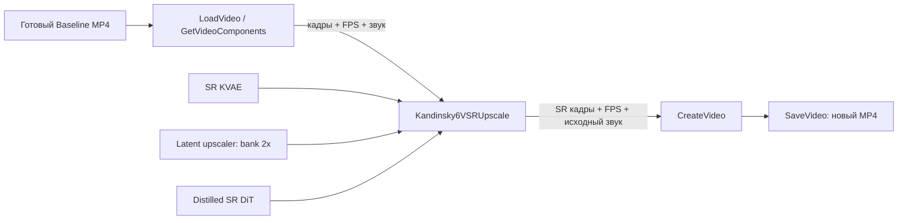

# Kandinsky 6 SR: готовый Baseline MP4 → видео большего разрешения

<!-- study-navigation:start -->
**Основа:** [MIT 6.S184 / 2026](https://diffusion.csail.mit.edu/2026/index.html) · [Основной конспект](https://diffusion.csail.mit.edu/2026/docs/lecture_notes.pdf) · [Учебная карта](../curriculum/README.md) · [Полное содержание](../curriculum/CONTENTS.md).
<!-- study-navigation:end -->

Здесь используется отдельная модель [Kandinsky 6 VSR distilled 2 steps](https://huggingface.co/kandinskylab/Kandinsky-6.0-VSR-distilled2steps-5s-Diffusers) из [официальной коллекции VSR](https://huggingface.co/collections/kandinskylab/kandinsky-60-vsr). Она получает уже сгенерированные кадры. Повторно запускать Lite Sampler, Qwen/CLIP или аудиогенератор не требуется.

**Статус на 30 октября 2026:** оба графа установлены в локальную ComfyUI Desktop. Входной Baseline MP4 и связи узлов проверены; геометрия, сохранение 121 кадра при 24 FPS и обрезка аудио проверены небольшими CPU-примерами оригинальных функций. Веса SR отсутствуют, pretrained SR не запускался. При первой проверке на SSD оставалось около 3,7 GB; весь SR bundle занимает ещё 17,45 GB. Это подготовленный workflow, а не полученный результат SR. [Машиночитаемый отчёт](reports/sr-workflows-validation.json).

## 1. Открыть отдельный граф

В **Workflows → K6 Research** выберите **Kandinsky 6 SR - 2x** или **Kandinsky 6 SR - 2.25x**. Копии также находятся в `example_workflows` установленного расширения `kandinsky6-sr`. Если список уже был открыт, обновите его; перезапуск сервера не требуется. Открытие графа не ставит его в очередь.

Для другой установки импортируйте JSON перетаскиванием на ComfyUI:

| Граф | Вход | Рассчитанный выход при `target_resolution=none` |
|---|---|---|
| [SR ×2](workflows/k6_sr_standalone_2x.json) | 864×480, 121 кадр, 24 FPS | 1728×960, 121 кадр, 24 FPS |
| [SR ×2,25](workflows/k6_sr_standalone_2_25x.json) | тот же Baseline | 1952×1088, 121 кадр, 24 FPS |

Эти размеры подтверждены функциями расчёта формы, а не декодированием pretrained SR.

## 2. Выбрать результат Baseline

Наш исходный файл: `/Users/vladmac/ComfyUI-Shared/output/kandinsky6_research/baseline_00001_.mp4`. Его проверенная копия уже лежит в `/Users/vladmac/ComfyUI-Shared/input/k6_baseline_864x480_121f.mp4` и выбрана в **LoadVideo** обоих графов. Исходный MP4 остаётся на месте.

Чтобы обработать другой результат, скопируйте его в корень настроенной папки ComfyUI `input`, затем выберите имя в **LoadVideo**. Эта версия узла перечисляет файлы верхнего уровня папки. Входом служит MP4, а не объект LATENT из Sampler: у SR собственный codec и другой latent contract.



**GetVideoComponents** разделяет MP4 на RGB-кадры, аудио и FPS. SR кодирует кадры своим KVAE, повышает разрешение latent tiles, уточняет их SR DiT, декодирует и смешивает перекрытия. **CreateVideo** получает все три выхода SR-узла, поэтому длительность аудио согласуется с обработанными кадрами. В проверенном примере это 222338 аудиосэмплов при 44100 Hz. **SaveVideo** записывает новый H.264 MP4 со звуком. Это повторное кодирование аудио, не побитовая копия AAC-потока.

Данный граф рассчитан на 5-секундный Baseline. Установленная SR-реализация приводит частоту кадров к своему целевому режиму и ограничивает последовательность 121 кадром с temporal alignment. Для длинного видео сначала нужен отдельный план сегментации и стыковки.

## 3. Подготовить только SR bundle

Потребуются три файла весов и пять JSON из одного checkpoint. Полные имена, размеры и SHA-256: [sr-model-manifest.json](workflows/sr-model-manifest.json). Закреплённая ревизия: `3d6672923a4dfcd387961864654e123dd53b8ee4`.

| Компонент | Файл весов внутри bundle | Размер, GB |
|---|---|---|
| SR DiT | `transformer/diffusion_pytorch_model.safetensors` | 3,19 |
| KVAE | `vae/diffusion_pytorch_model.safetensors` | 6,96 |
| Latent-upscaler bank | `latent_upscaler/diffusion_pytorch_model.safetensors` | 7,31 |

Размер всего набора — **17 451 308 451 байт: 17,45 GB или 16,25 GiB**. Это размер на диске, не peak памяти процесса. Объём SSD должен также покрывать выходы и рабочий запас системы. Загрузка в рамках подготовки графа не выполнялась: свободного места было меньше размера bundle.

После освобождения диска можно воспользоваться SR-кнопкой **Download models** в заметке графа. Она относится к SR bundle и использует ветку `main` источника. Для точного воспроизведения сравните файлы с manifest; альтернатива — загрузить файлы из закреплённой ревизии вручную, сохранив структуру внутри `models/diffusion_models`:

```text
Kandinsky-6.0-VSR-distilled2steps-5s-Diffusers/
├── model_index.json
├── scheduler/scheduler_config.json
├── transformer/
│   ├── config.json
│   └── diffusion_pytorch_model.safetensors
├── vae/
│   ├── config.json
│   └── diffusion_pytorch_model.safetensors
└── latent_upscaler/
    ├── config.json
    └── diffusion_pytorch_model.safetensors
```

В нашей Desktop-установке корень моделей — `/Users/vladmac/ComfyUI-Shared/models`. JSON нужны для распознавания и настройки компонентов; три одноимённых файла весов нельзя складывать в одну папку или переименовывать произвольно. После добавления файлов обновите список моделей и проверьте выбор в трёх загрузчиках.

## 4. Проверить параметры и выполнить первый SR

Сначала выберите ×2: `seed=42`, `tiles_batch_size=1`, `overlap=0.2`, `target_resolution=none`, `use_nabla=false`. В **Latent Upscaler Loader** выбран bank **2x** для обоих графов: дробный ×2,25 реализуется предварительным pixel resize ×1,125 и последующим latent upscale ×2. Отдельный ×2,25 checkpoint не нужен.

Для ×2,25 промежуточные размеры выравниваются по 16: 864×480 → 976×544 → 1952×1088. Режим `fullhd` затем вписывает результат в рамку 1920×1080 с сохранением аспекта, получая **1920×1070**. Он не обещает ровно 1920×1080.

Виджет `steps=2` отражает выбранную distilled-модель. В установленном коде её фактическое число вызовов SR DiT задаётся π-Flow contract: **2 NFE на batch тайлов**, а не два вызова на весь ролик. Увеличение виджета не превращает этот checkpoint в многопроходную обычную модель. [Исходный sampler](https://github.com/kandinskylab/kandinsky-6-sr/blob/b15e2aac526519c51f59dfec2b848355bb8902de/comfyui/kandinsky6_vsr/sampling.py).

Расширение [документирует CUDA-установку](https://github.com/kandinskylab/kandinsky-6-sr/blob/b15e2aac526519c51f59dfec2b848355bb8902de/comfyui/README.md). Полный SR на M3 Max/MPS и его peak memory в этом стенде **не проверены**. Успешный Lite Baseline с HunyuanVideo VAE не доказывает работоспособность другого KVAE и SR DiT. Batch=1 ограничивает число одновременно обрабатываемых тайлов; он не гарантирует, что вся модель и codec поместятся в память.

Когда веса доступны и запуск уместен, нажмите **Run** только в отдельном SR-графе. Выходы сохраняются под `output/kandinsky6_research/sr_2x/` или `sr_2_25x/`. Файл Baseline не перезаписывается. SR заново вычисляется из сохранённого MP4 и не зависит от живого кэша Lite Sampler.

## 5. Измерить и сделать вывод

Зафиксируйте checkpoint/revision, версию ComfyUI/SR-расширения, устройство, seed и scale. Для первого запуска запишите wall time с загрузкой моделей, для повторного — отдельно время с уже загруженными весами. Измерьте peak памяти, число кадров, размер, FPS, длительность и наличие звука. Сравните ×2 и ×2,25 при одинаковом источнике и параметрах: детали лица/текста, границы тайлов, мерцание и audio sync.

Без high-resolution ground truth нельзя обоснованно объявить прирост PSNR/SSIM или восстановление истинных деталей. Для учебного теста возьмите своё исходное HR-видео, уменьшите его, затем сравните SR с исходником и обычным resize. На генеративном Baseline результат — наблюдение о визуальном качестве и ресурсах, а не доказательство точной реконструкции.

Теоретический вход: [MIT 6.S184, Lecture 4 и Lab 3](../lecture_04/README.md) → [VAE и tiling](../vae/README.md) → [K6 π-Flow](notebooks/10_piflow_distillation.ipynb). SR conditioning, codec и сетка тайлов — отдельные промышленные контракты, которые не следует приписывать реализации MIT lab.

## Воспроизведение графов и источники

Графы производны от официального ComfyUI SR-примера на ревизии `b15e2aac526519c51f59dfec2b848355bb8902de`; установленный шаблон совпал с этой версией по SHA-256. [Атрибуция и лицензия](THIRD_PARTY.md).

```bash
uv run --locked python kandinsky-6/scripts/build_sr_workflows.py \
  --template "/path/to/ComfyUI/custom_nodes/kandinsky6-sr/example_workflows/Kandinsky 6.0 Video Super Resolution.json"

uv run --locked python kandinsky-6/scripts/validate_sr_workflows.py \
  --comfy-root "/path/to/ComfyUI" \
  --input-root "/path/to/ComfyUI/input" \
  --models-root "/path/to/ComfyUI/models/diffusion_models"
```

Проверка использует работающий локальный сервер и Python уже установленной ComfyUI для CPU-контрактов. Она не скачивает веса и не отправляет задания. Для перенесённой папки `input` укажите фактический путь; дополнительные `--models-root` можно повторять.
