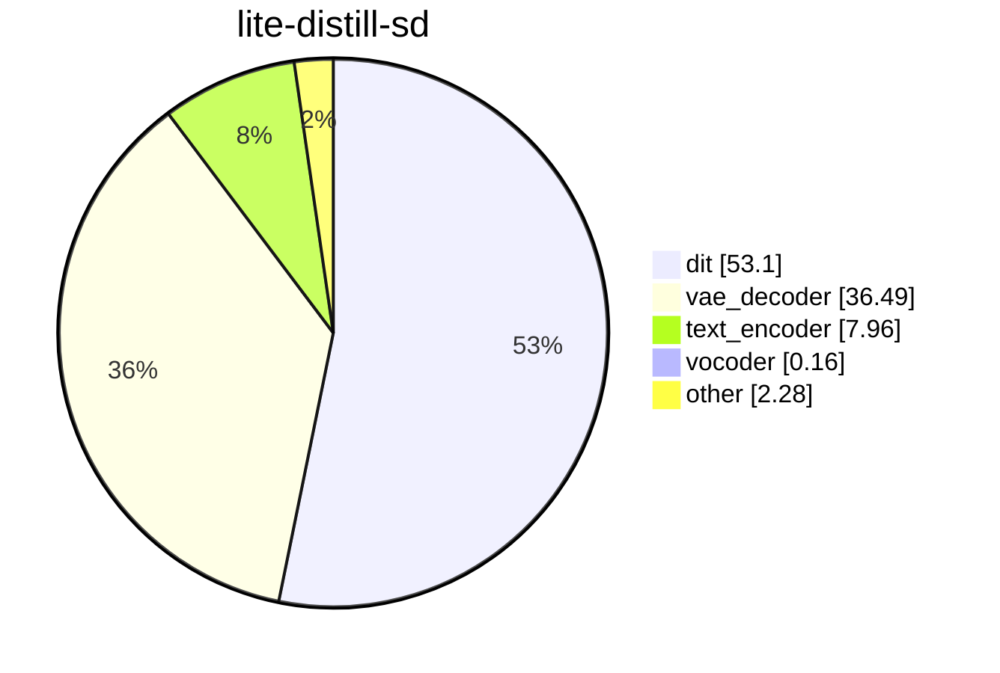
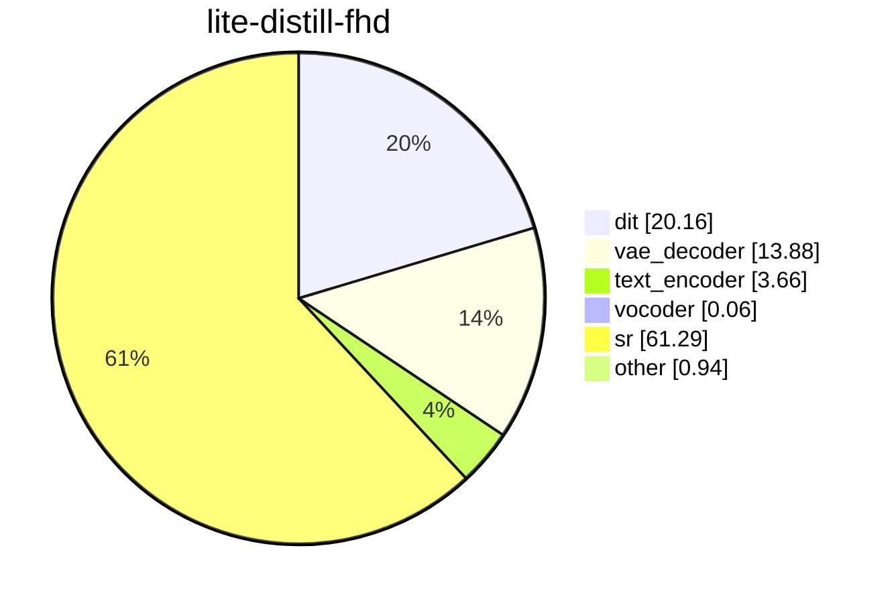
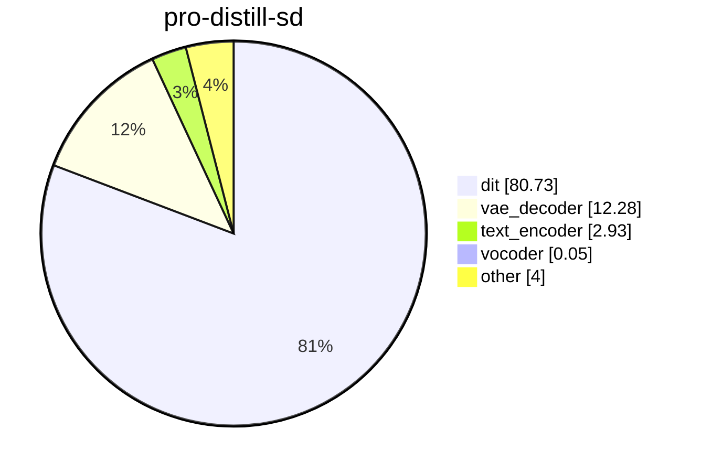
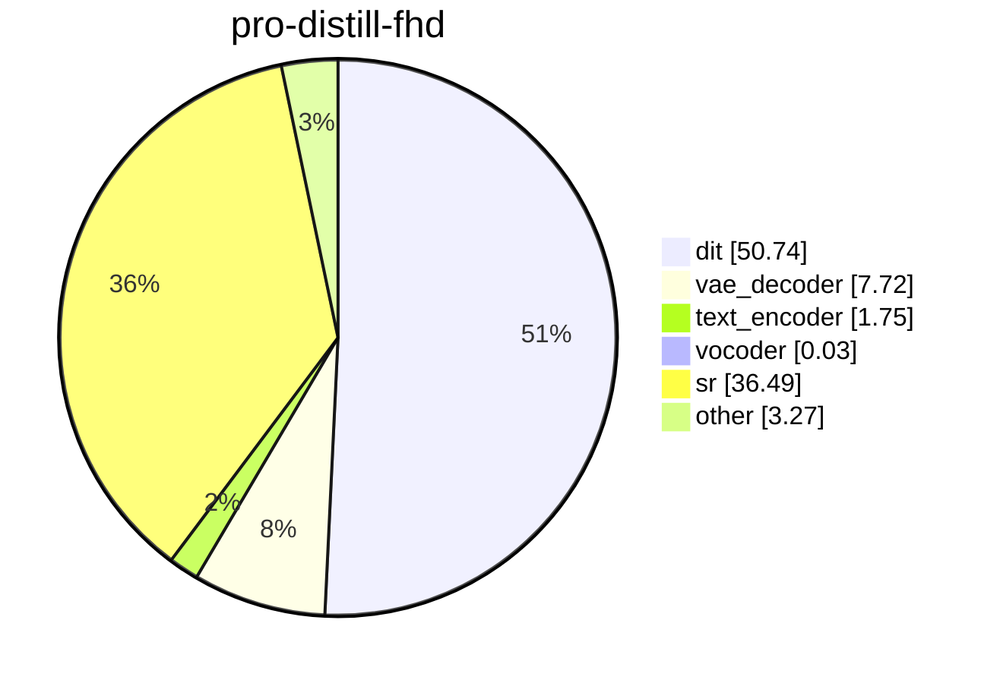
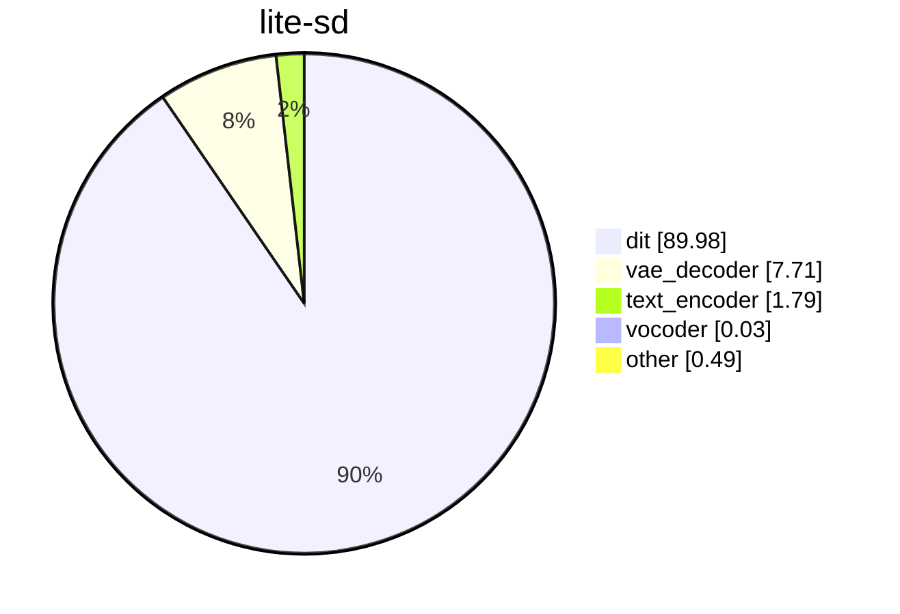
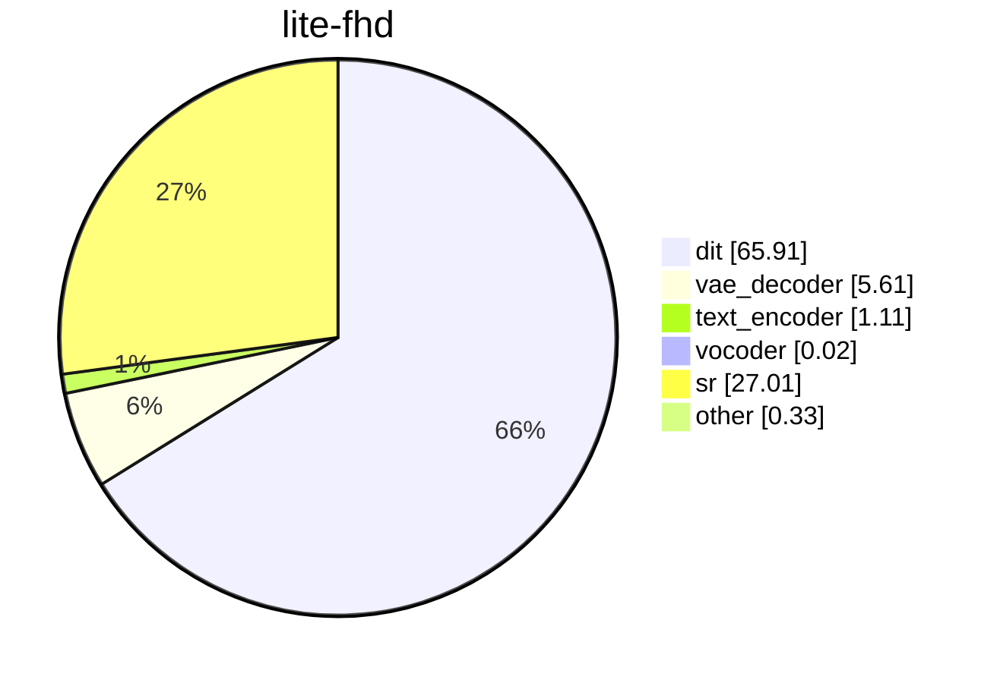
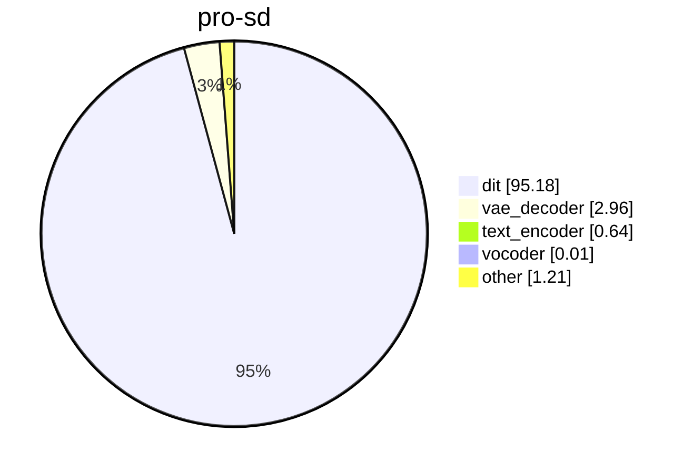
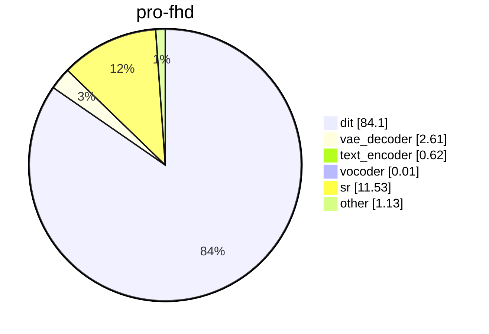

# Module time share

Collected profiles on NVIDIA A100-SXM4-80GB.

SageAttention, Qwen in BF16, compile torch. Each cell is one profiled generation. Lite stays resident. Pro uses module offload. The base clip is 480×864 with audio. Full HD is that clip plus the distilled 2-step model at scale 2.25. Distilled checkpoints use PiFlow, 10 steps, and guidance 1. The other checkpoints use 50 steps, guidance 5, and MagCache.

The seconds in the table are that profile, base plus super-resolution. A slice is that module's share of the same total. Slices under 0.01% are omitted.

## Charts

### Lite distill

### Pro distill

### Lite

### Pro

## Share of total time, %

| run | s | offload | dit | vae_decoder | text_encoder | vocoder | audio_vae_decoder | text_encoder_2 | sr | other |
| --- | ---: | --- | ---: | ---: | ---: | ---: | ---: | ---: | ---: | ---: |
| lite-distill-sd | 78.6 | none | 53.1 | 36.5 | 7.96 | 0.16 | &lt;0.01 | &lt;0.01 | 0 | 2.28 |
| lite-distill-fhd | 207.1 | none | 20.2 | 13.9 | 3.66 | 0.06 | &lt;0.01 | &lt;0.01 | 61.3 | 0.94 |
| pro-distill-sd | 236.0 | module | 80.7 | 12.3 | 2.93 | 0.05 | &lt;0.01 | &lt;0.01 | 0 | 4.00 |
| pro-distill-fhd | 375.4 | module | 50.7 | 7.72 | 1.75 | 0.03 | &lt;0.01 | &lt;0.01 | 36.5 | 3.27 |
| lite-sd | 371.6 | none | 90.0 | 7.71 | 1.79 | 0.03 | &lt;0.01 | &lt;0.01 | 0 | 0.49 |
| lite-fhd | 508.0 | none | 65.9 | 5.61 | 1.11 | 0.02 | &lt;0.01 | &lt;0.01 | 27.0 | 0.33 |
| pro-sd | 980.4 | module | 95.2 | 2.96 | 0.64 | 0.01 | &lt;0.01 | &lt;0.01 | 0 | 1.21 |
| pro-fhd | 1109.8 | module | 84.1 | 2.61 | 0.62 | 0.01 | &lt;0.01 | &lt;0.01 | 11.5 | 1.13 |
