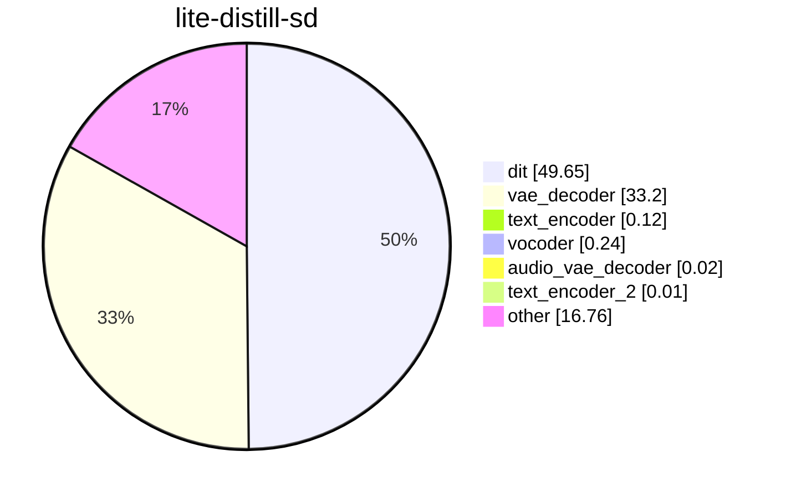
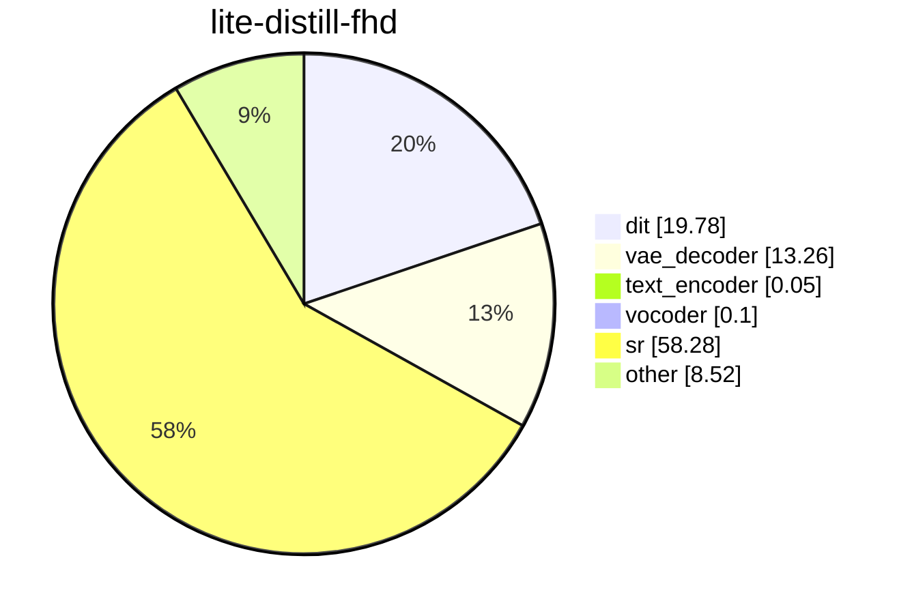
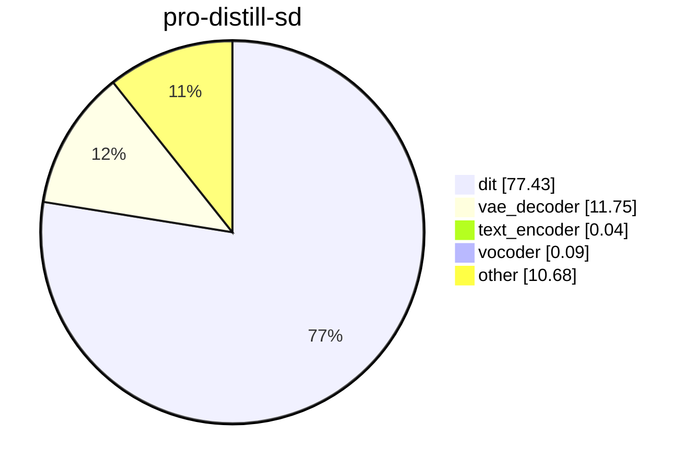
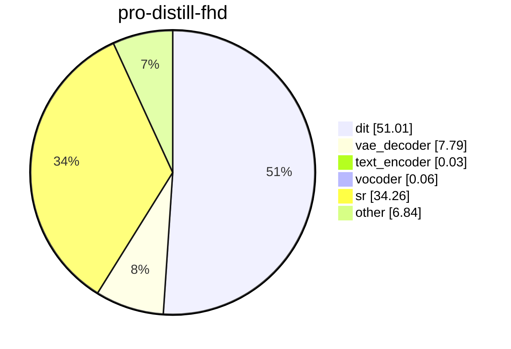
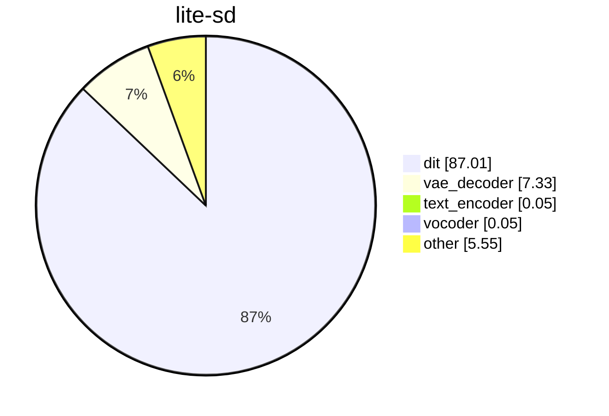
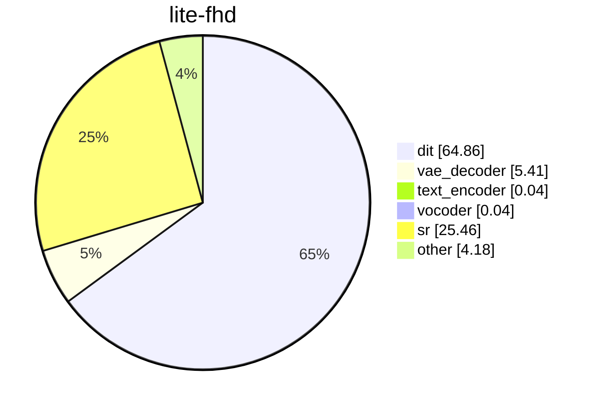
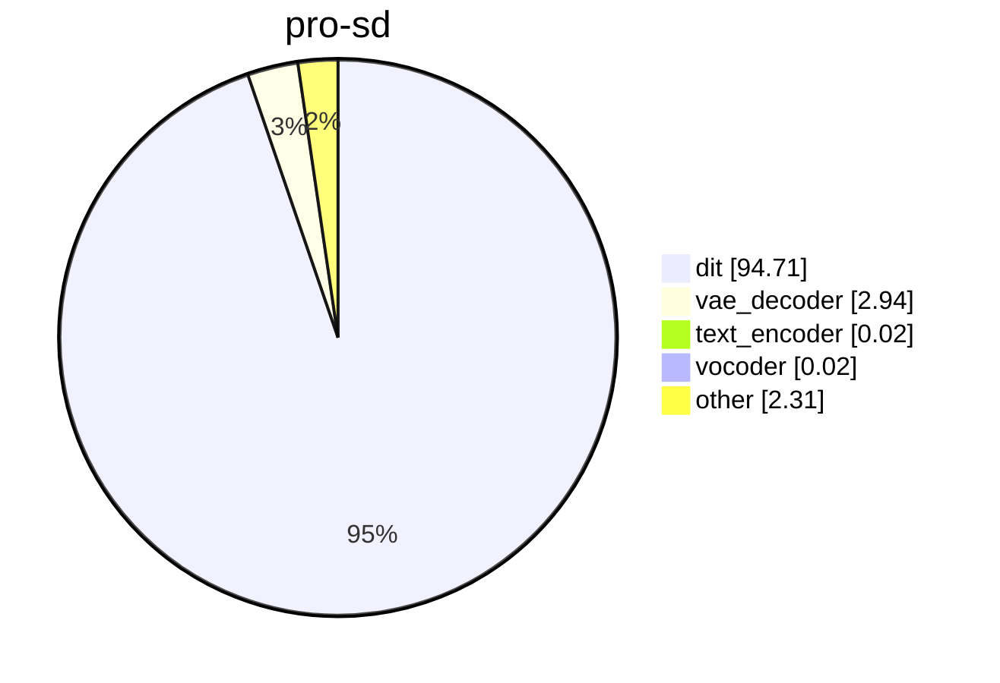
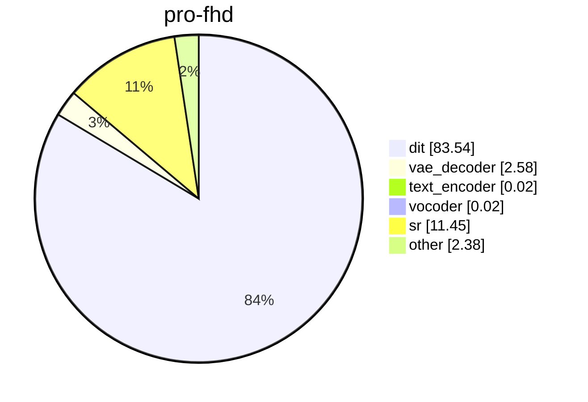

# Module time share

Run `bench_2026-10-20T20-54-28` on NVIDIA H100 80GB HBM3.

This is `just bench`. Attention is FlashAttention 3. Qwen is BF16. Compile is torch. The base clip is 480×864 with audio. Full HD super-resolves that clip with the distilled 2-step model at scale 2.25. Distilled checkpoints use PiFlow, 10 steps, and guidance 1. The other checkpoints use 50 steps, guidance 5, and MagCache. Offload is the lightest strategy that fits on the card.

The seconds in the table are the median of up to three finished generations. A slice is the median time of that module across those generations, as a share of the sum of those medians. Slices under 0.01% are omitted.

## Charts

### Lite distill

### Pro distill

### Lite

### Pro

## Share of total time, %

| run | s | offload | dit | vae_decoder | text_encoder | vocoder | audio_vae_decoder | text_encoder_2 | sr | other |
| --- | ---: | --- | ---: | ---: | ---: | ---: | ---: | ---: | ---: | ---: |
| lite-distill-sd | 31.2 | none | 49.6 | 33.2 | 0.12 | 0.24 | 0.02 | 0.01 | 0 | 16.8 |
| lite-distill-fhd | 78.0 | module | 19.8 | 13.3 | 0.05 | 0.10 | &lt;0.01 | &lt;0.01 | 58.3 | 8.52 |
| pro-distill-sd | 87.8 | module | 77.4 | 11.7 | 0.04 | 0.09 | &lt;0.01 | &lt;0.01 | 0 | 10.7 |
| pro-distill-fhd | 133.2 | module | 51.0 | 7.79 | 0.03 | 0.06 | &lt;0.01 | &lt;0.01 | 34.3 | 6.84 |
| lite-sd | 143.2 | none | 87.0 | 7.33 | 0.05 | 0.05 | &lt;0.01 | &lt;0.01 | 0 | 5.55 |
| lite-fhd | 192.2 | module | 64.9 | 5.41 | 0.04 | 0.04 | &lt;0.01 | &lt;0.01 | 25.5 | 4.18 |
| pro-sd | 351.5 | module | 94.7 | 2.94 | 0.02 | 0.02 | &lt;0.01 | &lt;0.01 | 0 | 2.31 |
| pro-fhd | 399.7 | module | 83.5 | 2.58 | 0.02 | 0.02 | &lt;0.01 | &lt;0.01 | 11.5 | 2.38 |
