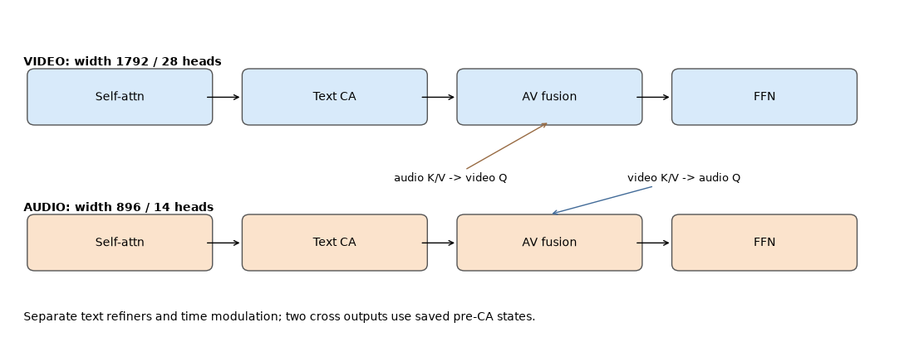
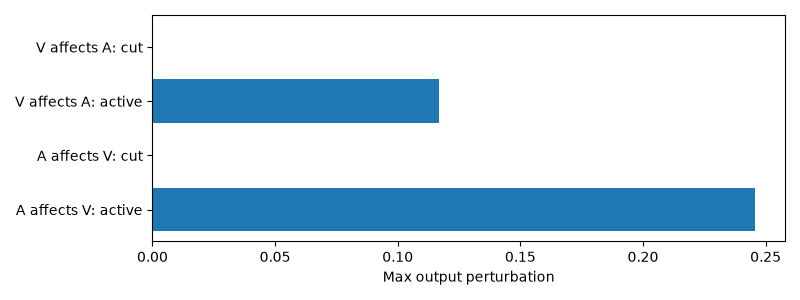
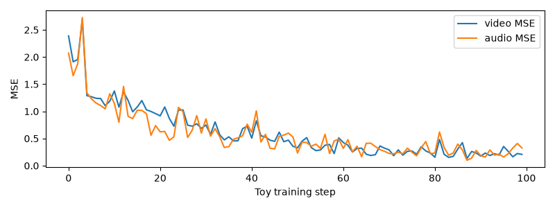
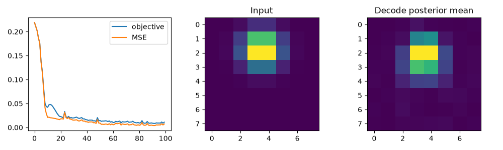
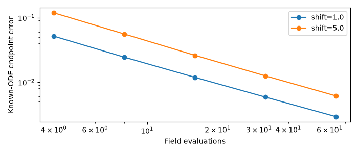

# K6 component labs: проверка 27 октября 2026

[Курс](../README.md) · [Полное содержание](../../curriculum/CONTENTS.md) · [Машиночитаемый execution report](component-validation.json).

**14 новых notebooks выполнены в отдельных свежих CPU kernels: 169 ячеек / 67 code cells.** Все assertions прошли, локальные ссылки проверены, 243 pinned source hashes совпали. Курс работает через основное зафиксированное окружение `uv run --locked --offline`; модельные веса/датасеты не загружались, ComfyUI jobs не отправлялись, MLX не исполнялся. Colab bootstrap подготовлен, но удалённый Colab runtime не проверялся.

## Что именно исполнялось

- Оригинальные native DiT / fused blocks / PiFlow wrapper на уменьшенных размерах, случайные веса; dense SDPA adapter явно описан в labkit.
- Оригинальные tensor-only schedule/CFG/Euler/PiFlow/conditioning/codec-wrapper functions.
- Изолированное оригинальное определение Hunyuan causal Conv3d, без загрузки полного VAE.
- Учебный MLP-VAE, synthetic joint FM training, аналитические ODE/grid controls.
- Там, где нужны pretrained encoders/decoder/vocoder, используются явно названные test doubles; они проверяют API/layout, не медиакачество.

## Измерения

| Опыт | Получено | Область вывода |
|---|---|---|
| Full Lite Distill constructor / meta | 3,177,988,112 parameters | Точная структура выбранного native config, без чтения 3B весов |
| Text padding perturbation | max error 0 | Mask закрывает padded K/V |
| Projection cache | 1 call на 2 reads | Time-independent projection reuse |
| Toy beta-VAE objective | 0.219008 → 0.011030 | Synthetic moving-blob data, 100 steps |
| Native causal Conv3d | past-output max error 0 | Изменено только будущее, kernel=3/stride=1 |
| STFT inverse | max error 7.45e-08 | Сохранённая complex phase, не mel vocoder |
| Visual patch manual/native | max error 0 | Порядок patch features |
| Zero residual gate | identity max error 0 | При этом modulation gradient ненулевой |
| Manual attention / SDPA | max error 4.44e-16 | FP64, small unmasked case |
| Text perturbation after text-CA cut | max change 0 | Изолирован token-level condition path |
| AV directional cuts | оба cut deltas = 0; active deltas ненулевые | Проверка wiring одного native fused block |
| Audio-output loss → video input | gradient norm 0.00476801 active / 0 cut | Межмодальный gradient path |
| Tiny joint FM held-out video MSE | 1.910945 → 0.212983 | 184,500 parameters, synthetic conditioning |
| Tiny joint FM held-out audio MSE | 1.380696 → 0.175592 | 100 training steps, один fixed validation batch |
| Oracle constant-grid policy | endpoint error 5.55e-17 | Аналитический контроль, student не обучался |
| Native tiny PiFlow sampler | 2 model NFE, finite outputs обеих модальностей | Grid-head/rollout contract, random weights |
| Native Euler CFG accounting | 4 calls при w=1, 8 при w=0/3 | 4 steps, analytic constant predictor double |
| Reference append/restore | max restore error 0 | Temporal reference + mask/TRE layout |
| ComfyUI Smoke | 12 nodes / 14 links | Только JSON/static inspection; runtime не запускался |

Исторические округления статьи по потокам не заменяются нашими числами: в `meta`-подсчёте fusion включает также cross-modal modulation. Логический размер attention score matrix — арифметическая оценка, а не измеренная peak memory SDPA/FlashAttention. CPU microtiming из notebook 13 относится только к tiny CPU сети и не экстраполируется на M3 GPU или pretrained Lite.

## Графики и их смысл



Два потока имеют разные widths; стрелки определяют источник K/V и получателя Q. Детали snapshot states объясняются в notebook 08.



При отключении нужного cross gate исчезает соответствующая input/output sensitivity. Это контроль структуры вычислений, не lip-sync benchmark.



Снижение loss относится к синтетическим latent distributions и небольшой native сети. Для validation используются другой seed/batch; статистика по нескольким обучающим seeds здесь ещё не проведена.



MLP beta-VAE показывает reconstruction/KL objective; это не тренировка Hunyuan/MMAudio codec.



У поля u=x известен точный endpoint, поэтому наблюдаем discretization error отдельно от ошибки neural predictor.

## Как повторить

```bash
uv run --locked --offline python kandinsky-6/scripts/validate_component_notebooks.py --execute
uv run --locked --offline python kandinsky-6/scripts/summarize_components.py
```

Execution outputs остаются в ignored `reports/executed/`, метрики и локальные изображения — `artifacts/component_labs/`. Здесь опубликованы summary JSON и выбранные фигуры. Notebook sources публикуются без outputs. Генераторы и hashes позволяют проверить, какие именно версии исполнялись.

## Что остаётся отдельным этапом

Pretrained AV generation, реальная реконструкция кодеками в ComfyUI, MPS/MLX parity, полный joint MLX pipeline, обучение voice-FiLM на VCTK latents, waveform sampling с адаптером и SECS/WER/FAD/no-reference regression. Эти этапы не выводятся из выполненных CPU контролей; прежнее решение пользователя об SSD 50 GB+ сохраняется. [Статус исследования](../STATUS.md).
