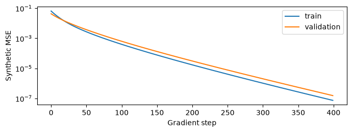

# Проверка K6 материалов — 27 октября 2026

Все **33 ячейки** manual notebook выполнены в свежем Python 3.12 Jupyter-ядре: **14 code cells**, без скачивания моделей, pretrained генерации и обучения голоса. При исполнении проверены диск, заголовки локальных файлов, links двух workflow, данные сохранённого VCTK pilot, FiLM identity, reference-context attention и знак Flow Matching пути. Source notebook публикуется без outputs; выполненная копия остаётся в ignored `reports/executed/`.

## Воспроизведение

Из корня репозитория:

```bash
uv run --locked python kandinsky-6/scripts/validate_manual_notebook.py --execute
```

По умолчанию `RUN_TORCH_FIXTURE=False`. Команда не запускает ComfyUI, не отправляет prompts и не устанавливает MLX. Отчёт текущего запуска — `artifacts/manual_experiment/manual-readiness-and-educational-results.json`.

## Что измерено

| Проверка | Результат |
|---|---|
| Notebook schema и Python syntax | PASS |
| Выполнение учебного маршрута | 33 cells / 14 code cells, PASS |
| Zero-FiLM max error | 0 |
| Изменение attention при reference prefix | max abs ≈ 1.1872; это случайные признаки, не измерение K6 |
| Synthetic validation MSE | 0.0427773 → 0.000000155515 за 400 gradient steps |
| Links каждого Lite workflow | 12 nodes / 14 links, согласованы |
| Сохранённые исходники из manifest | 243 файла, SHA-256 совпали |
| VCTK pilot | 120 клипов; 16 reference / 63 train / 20 validation / 21 test; 0 cross-split text overlap |
| Свободное место | около 24.2 GiB при проверке; выбранный пользователем 50 GB gate не пройден |

[Машиночитаемые учебные результаты](educational-results.json), [VCTK аудит](vctk-pilot-preparation.json), [окружение](environment-probe.json).



На графике Linear FiLM восстанавливает известное синтетическое преобразование случайных признаков. Это демонстрирует gradient при zero-init и работу MSE, **не клонирование голоса**.

CPU fixture native K6 класса также ранее выполнен в Python ComfyUI (Torch 2.12.1): 50 632 audio parameters, output [1,12,40], случайные веса. Это тестовый уменьшенный класс, не pretrained inference.

## Что не проверено

- Pretrained генерация в ComfyUI; время/память полной модели и качество AV.
- Numerical parity MLX: установка остановлена после network timeout и решения отложить запуск.
- Pretrained audio-only parity и полный joint PiFlow pipeline на MLX.
- FiLM training на реальных latents, waveform sampling с адаптером, SECS/WER/FAD и no-reference regression.

Графы статически проверены и установлены в Desktop, но импорт графа не доказывает работу всех nodes с весами. Публичные проценты улучшения и timings из статей не включаются в наши результаты.
