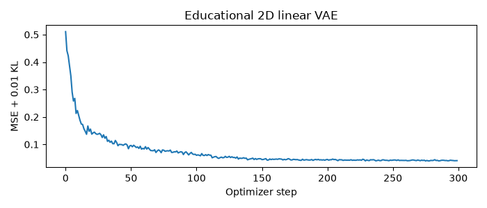
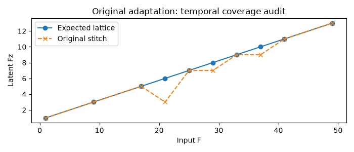
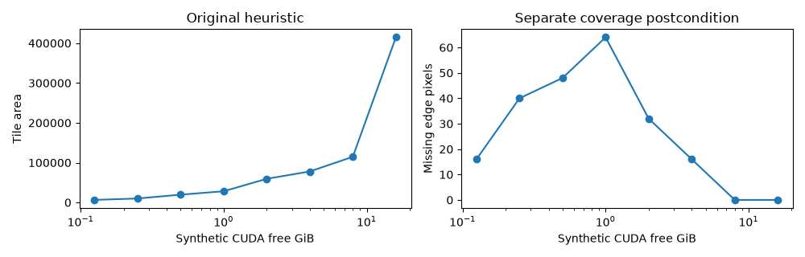
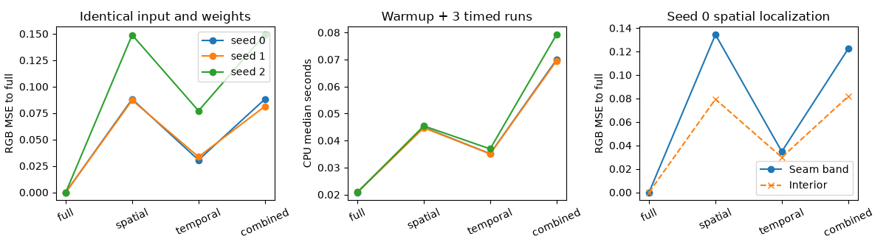
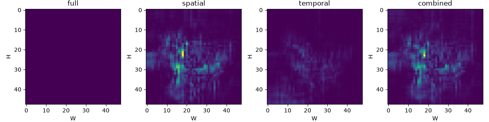

# HunyuanVideo VAE: проверка и измеренные результаты

[Маршрут](../README.md) · [Источник и область выводов](../SOURCE_MAP.md) · [Полный JSON](execution.json) · [CSV benchmark](tiny-benchmark.csv).

**9/9 notebooks исполнены в свежих CPU kernels**, 51 code cells, 123 cells всего. Дата UTC: 2026-10-27T16:36:45.770334+00:00. Python: 3.12.14, PyTorch: 2.14.1. Pinned source SHA: `f5e8dd402aba625f23aef86ab7d5324dc6a4e8585b72917a3bf27bd46745bbaf`. Report содержит hashes каждого notebook и helper, чтобы не приписывать старый результат новому коду.

Pretrained weights не загружались. GPU peak memory, Diffusers runtime, MPS execution и ComfyUI jobs **не проверялись**. Timings ниже — локальный CPU, synthetic RGB и random reduced native encoder/decoder; это не latency/quality Hunyuan checkpoint.

Все 32 display formulas прошли строгий KaTeX parse/render: [отчёт](math-rendering.json). Два локальных HTML previews и графики осмотрены; это не проверка GitHub/Colab browser parity. Ссылки на MIT Q4.1–Q5.1 и исходные cell indices сверены по canonical notebook.

## Теория и локальные операторы

| Проверка | Измерение | Допустимый вывод |
|---|---|---|
| ELBO MC | -2.119223; exact log p(x) -1.204355; MC SE 0.004662 | Lower bound согласован с известной scalar marginal |
| Closed-form KL vs torch | max error 0 | Gaussian algebra и reductions согласованы |
| MIT Q4.7 Gaussian reconstruction NLL vs torch | max error 2.84e-14 | Learned-variance likelihood и sum reduction согласованы |
| Reparameterization gradient | max finite-difference error 4.44e-12 | Pathwise derivative проверена при фиксированном ε |
| Conv future perturbation | prefix error 0 | Default isotropic native conv causal |
| GroupNorm future perturbation | prefix error 2.912175 | Whole-tensor GN не strict online causal |
| Manual attention vs SDPA | max error 1.19e-07 | Attention formula/mask согласованы на малом тензоре; не full Diffusers parity |
| Local convolution with halo | max error 0 | Halo+crop exact для этого локального оператора |



## Stitching и coverage

Aligned coordinate oracle дал **точное совпадение** spatial и temporal outputs с full. Это проверка indices без context. Random native codec дал ненулевое отличие, несмотря на одинаковые input/weights.

Spatial counterexample: L=88,Q=32,S=24 оставляет 8 pixels; фактическая latent width=10, ожидается 11. Этот вызов относится к приложенной адаптации, не ко всем upstream versions. Temporal sweep проверяет настоящий `_encode` dispatch; короткий input не отправлялся в неподходящий tile path.

| Input F | Expected Fz | Actual Fz | Shape |
|---|---|---|---|
| 1 | 1 | 1 | OK |
| 9 | 3 | 3 | OK |
| 17 | 5 | 5 | OK |
| 21 | 6 | 3 | tail missing |
| 25 | 7 | 7 | OK |
| 29 | 8 | 7 | tail missing |
| 33 | 9 | 9 | OK |
| 37 | 10 | 9 | tail missing |
| 41 | 11 | 11 | OK |
| 49 | 13 | 13 | OK |



Original planner на CPU/MPS использует бесконечный budget. Synthetic CUDA sweep выявляет, где grid coverage требует дополнительной проверки; very low budget может давать invalid stride. Это не измеренная VRAM и не подтверждение OOM safety.



## Paired CPU tiny benchmark

Input B=1,C=3,F=33,H=W=48. Native widths 4/8/8/8, latent=2, layers=1, mid attention=False. Mode posterior, three seeds; у каждой policy warmup и 3 timed repeats. «MSE к full» означает deviation от той же случайной модели, а «PSNR к input» — reconstruction случайного codec на RGB range=2.

| Seed | Policy | Median CPU seconds | MSE to full | PSNR to input dB | Seam MSE | Interior MSE |
|---|---|---|---|---|---|---|
| 0 | full | 0.02083 | 0.000000 | 10.622 | 0.000000 | 0.000000 |
| 0 | spatial | 0.04487 | 0.088170 | 11.429 | 0.134402 | 0.079382 |
| 0 | temporal | 0.03512 | 0.030603 | 10.841 | 0.034720 | 0.029821 |
| 0 | combined | 0.06992 | 0.088173 | 11.494 | 0.122260 | 0.081693 |
| 1 | full | 0.02089 | 0.000000 | 10.173 | 0.000000 | 0.000000 |
| 1 | spatial | 0.04472 | 0.087147 | 10.422 | 0.092668 | 0.086097 |
| 1 | temporal | 0.03506 | 0.033588 | 10.222 | 0.025893 | 0.035051 |
| 1 | combined | 0.06951 | 0.081332 | 10.478 | 0.082232 | 0.081161 |
| 2 | full | 0.02086 | 0.000000 | 9.188 | 0.000000 | 0.000000 |
| 2 | spatial | 0.04540 | 0.148894 | 8.973 | 0.135912 | 0.151362 |
| 2 | temporal | 0.03691 | 0.077158 | 9.254 | 0.088860 | 0.074934 |
| 2 | combined | 0.07923 | 0.149232 | 9.232 | 0.156105 | 0.147926 |





На выбранной grid все policies сохранили BCTHW. Spatial/temporal/combined outputs отличались от full у всех трёх seeds, включая interior. Это поддерживает гипотезу о неэквивалентности с context/normalization. Full baseline совпал сам с собой. Нулевой oracle error и ненулевой native error показывают разницу index correctness и full-model equivalence.

Tiling повторяет overlapping вычисления, поэтому CPU time может вырасти. Отсюда нельзя заключить, сколько VRAM экономится или какой tile быстрее на CUDA/MPS. Header source утверждает lower peak относительно Diffusers, но это требует отдельного pretrained paired benchmark.

## Воспроизведение и следующий шаг

```bash
uv run --locked --offline python vae/scripts/validate_labs.py --execute
uv run --locked --offline python vae/scripts/summarize_labs.py
```

Clean authored notebooks не содержат outputs; полные исполненные копии — в ignored `artifacts/executed/`. CSV/JSON и выбранные PNG публикуются как компактное evidence. [Lab 08](../notebooks/08_pretrained_and_comfyui_protocol.ipynb) содержит ручной no-download pretrained/ComfyUI протокол после SSD gate. Для реального вывода нужны local checkpoint SHA, clips, paired float reconstructions, synchronized latency и настоящий memory measurement.
